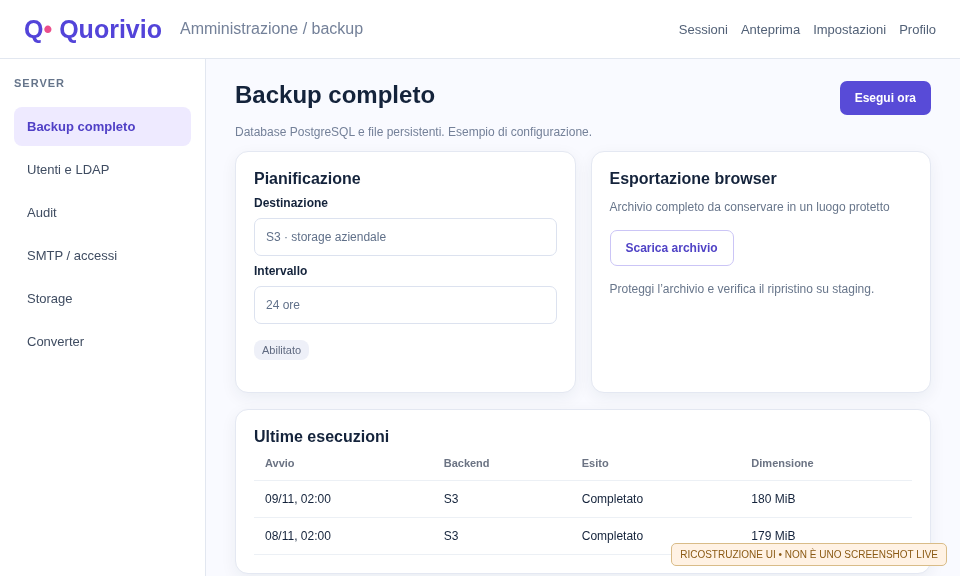
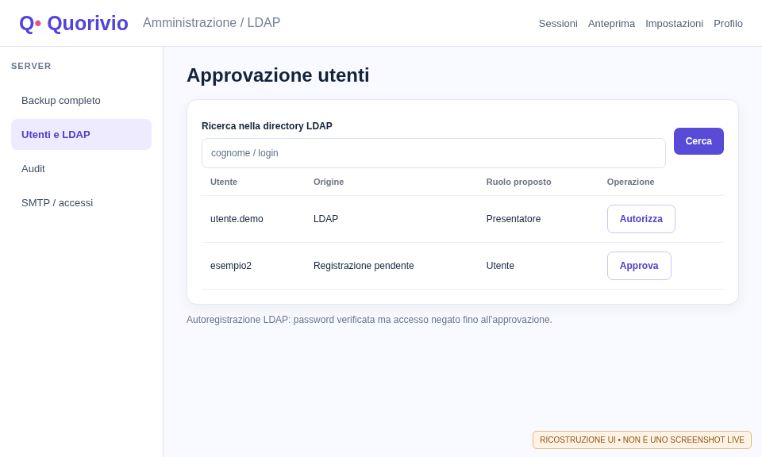
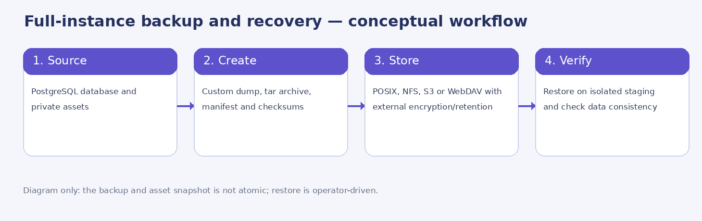
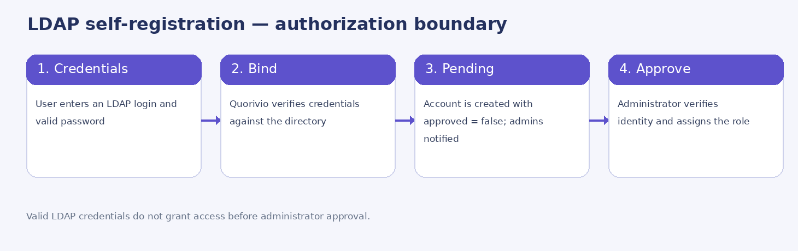

# Administrator guide

**Quorivio 0.1.0-dev · Documentation build RC278 · 9 November 2026**

Technical and operational manual for installation, configuration, identity management, backups, monitoring, audit logging, maintenance and disaster recovery. Procedures reflect the RC276 source and deployment charts; they do **not** certify a production environment. **Explanatory UI illustrations in earlier chapters are reconstructions**, labelled as such. When the CI-produced PDF includes the final gallery, it contains genuine screenshots of the disposable live application, verified against hashes and commit. Independent D5 editorial review remains required.

## 1. Architecture and responsibilities

Quorivio combines a React/Vite frontend, Node/Express API, PostgreSQL 18 as the authoritative data store, WebSocket and PostgreSQL LISTEN/NOTIFY for live synchronization, persistent asset storage, an isolated PDF/PPTX converter and ClamAV for uploaded-file scanning. Deployment options include Compose, Helm and a standalone Kubernetes wizard. Multiple replicas require explicit validation of RWX storage, ingress, session continuity and data synchronization.

| Component | Purpose | Operator check |
|---|---|---|
| API + frontend | Authentication, session editor, responses, exports | Readiness, HTTPS, version parity, audit. |
| PostgreSQL 18 | Users, sessions, answers and configuration | TLS, backup, migrations, disk and restore. |
| Assets volume | Media, backgrounds, portraits and uploads | Persistence, ownership, quota and replication. |
| ClamAV | Upload malware scanning | Health, signature updates, production fail-closed behavior. |
| Converter | PDF/PPTX page import | Worker image, shared mount, private token, limits and logs. |
| Backup engine | Custom PostgreSQL dump + asset archive | Scratch space, destination, credentials, off-system retention. |
| SMTP/LDAP/OIDC | Identity and notifications | TLS, mapping, authorization and credential lifecycle. |

**Responsibility model:** the instance operator determines infrastructure, legal basis, authorization, retention, backups and incident handling. A session owner manages that session; ownership does not imply cross-organization administrator rights.

## 2. Pre-installation checklist

1. Choose the external DNS name and provision a valid TLS certificate.
2. Decide between internal and external PostgreSQL and document upgrade responsibility.
3. Plan persistent asset storage (RWO for a suitable single replica; genuine RWX support for multiple replicas).
4. Generate unique secrets and keep them outside Git and unencrypted Helm values.
5. Provision a platform administrator and validate MFA and recovery procedures.
6. Set up SMTP, ClamAV and any LDAP/LDAPS or OAuth/OIDC providers to be used.
7. Enable only backup backends that can be reached and tested; perform an isolated restore drill.
8. Verify public ingress, service logs, disk alerts, account approval and retention policies.

A `0.1.0-dev` build must not be promoted to production on the strength of this manual alone. Review the current gate matrix and actual CI evidence separately.

## 3. Docker Compose deployment

The repository provides `compose.yaml`, `.env.compose.example`, `.env.example` and Dockerfiles. Create an environment file outside version control, separate database passwords from administrator credentials and provide durable volumes for PostgreSQL, the private `assets` directory and backups. Persistent records must never depend on an ephemeral container filesystem.

### 3.1 Important environment variables

| Variable | Meaning and caution |
|---|---|
| `DATABASE_URL` | PostgreSQL endpoint and credentials; protect connections where appropriate. |
| `PUBLIC_BASE_URL` | External HTTPS URL used to generate join links and QR codes. |
| `ADMIN_EMAIL`, `ADMIN_PASSWORD` | Bootstrap administrator identity; rotate password and restrict exposure. |
| `NODE_ENV=production` | Production restrictions including mandatory antivirus scanning. |
| `SMTP_HOST/PORT/SECURE/USER/PASSWORD/FROM` | Outgoing notifications; implicit TLS for SMTPS when enabled. |
| `QUORIVIO_WORKER_TOKEN` | Strong private converter authentication token. |
| `QUORIVIO_AV_REQUIRED` | Antivirus requirement; not a production bypass switch. |

### 3.2 Basic smoke test

Confirm API and DB readiness, ClamAV health and converter health when enabled. Sign in as administrator, create a disposable session, submit an answer from a separate browser and inspect authorized results. Restrict log access and avoid recording cookies, passwords, tokens or personal answer payloads.

## 4. Kubernetes and Helm

The chart lives in `helm/quorivio`. Use an environment-specific values file and an existing Kubernetes Secret for credentials. Inspect `helm template` output before deployment: ingress, mounts and resource requests must match the cluster. Helm cannot automatically supply a missing NFS service or CSI driver.

### 4.1 Principal chart options

| Values key | Function |
|---|---|
| `image.repository`, `image.tag`, `image.pullPolicy` | Application image (`desalvo/quorivio`; `latest` on main). |
| `replicaCount` | Number of API pods, subject to state and storage constraints. |
| `existingSecret` | Name of the application's Kubernetes Secret. |
| `publicBaseUrl` | External public HTTPS URL. |
| `assets.existingClaim` | Existing PVC for durable assets. |
| `assets.accessMode/size/storageClassName` | Storage access mode, size and class. |
| `ingress.className/host/tlsSecret` | Routing and TLS termination. |
| `antivirus.image` | ClamAV pod sidecar image. |
| `converter.image` | Isolated conversion worker image. |

### 4.2 NGINX and HAProxy ingress

Choose the ingress class actually installed in the cluster. NGINX and HAProxy Technologies have different conventions, including legacy HAProxy annotations in some deployments. Check request-size limits against the API, as well as timeouts and WebSocket upgrade handling. A correct ingress class alone does not prove public TLS reachability.

### 4.3 Persistent volumes and multiple replicas

`ReadWriteOnce` is not proof that several pods on different nodes can share writable assets. Use a genuinely RWX-capable storage backend when multiple API replicas need shared media. Test UID/GID, permissions, file locking, graceful termination, simultaneous migrations and reconnection after pod replacement. Do not raise `replicaCount` before completing these tests.

## 5. Standalone Kubernetes wizard

`tools/k8s_wizard.py` configures new or revised Kubernetes manifests for PostgreSQL, ingress, volumes, converter, LDAP and backups. **Never commit** generated Secrets or private overrides. For an installed cluster, generate into a separate directory, compare with the live desired state and retain custom converter and database patches.

Example with non-sensitive values:

```bash
python3 tools/k8s_wizard.py --no-self-update --unattended \
  --output ./k8s-generated \
  --set host=quorivio.example.org
kubectl kustomize ./k8s-generated > /tmp/quorivio-rendered.yaml
```

Do not supply `ldap_bind_password`, S3 secret keys or API tokens in command-line history. Rotate secrets in a controlled change window, review `kubectl diff`, and maintain a tested rollback procedure.

## 6. PostgreSQL 18, migrations and consistency

PostgreSQL stores identities, sessions, answers, audit and backup settings. Install `pg_dump`/`pg_restore` clients compatible with the server. A major version upgrade requires a supported upgrade or dump/restore procedure: changing the database image tag alone is not sufficient.

For an external database, verify host, port, `DATABASE_URL`, TLS certificate trust and server identity, SQL privileges, latency and availability. Do not disable certificate verification merely to silence connection errors. Internal deployments require durable PostgreSQL volumes and monitoring of WAL, indexes, tables, connection capacity and disk usage.

Test schema migrations on representative staging data. A successful SQL migration does not prove that referenced external asset files are present; validate an end-to-end session workflow afterward.

## 7. Full-instance backup

RC270 introduced **administrator full export**: PostgreSQL custom-format dump, persistent asset files, manifest and SHA-256 checksums in a compressed archive. In **Server configuration → Full backup**, an administrator can start a job or download a browser-delivered archive. The archive contains sensitive information; store it securely and apply appropriate encryption and access policies.

<figure><figcaption>Figure 1 — Reconstructed backup configuration: selected backend, schedule, manual execution, browser download and recent runs.</figcaption></figure>

### 7.1 Destinations and schedule

The current implementation supports **one active destination** for manual and scheduled operations, with a recurring interval of **1 to 720 hours**. The database coordinates scheduled claims across replicas. Recent run history records execution state; creating a job does not mean that a backup has succeeded. Browser download is independent of the stored remote destination.

| Backend | Configuration | Prerequisites and risks |
|---|---|---|
| **POSIX** | Path beneath a deployment-mounted root | Writable PVC, permissions and capacity. |
| **NFS** | Existing PVC or direct NFS server/export mount | UID 1000 permission, node connectivity, RWX when needed. |
| **S3 compatible** | HTTPS endpoint, bucket, region, credentials | SigV4, multipart, minimal IAM scope and bucket lifecycle. |
| **WebDAV** | HTTPS URL, account and destination path | Verified TLS, writable remote service and quota policy. |

### 7.2 Manual backup and browser download

Open Full backup, configure an authorized backend, verify that it is enabled in the deployment and choose **Run now**. Check the run history until completion; a returned job ID is only an acknowledgement. Use the administrator browser export for a local archive. Validate the manifest, SHA-256 values and the archive contents before considering the copy usable.

### 7.3 Scheduler operations

Enable scheduling, choose an interval suited to database size and temporary storage and monitor timestamps, sizes and error codes. A green backup status is not a recovery guarantee until a restore drill succeeds. Separate source database retention from off-site archive lifecycle and deletion rules.

## 8. Helm backup configuration

Deployment controls decide which storage backends can be mounted and used; administrators can manage only authorized targets in the UI.

| Values path | Purpose |
|---|---|
| `backup.allowedBackends` | Remote backends enabled by deployment (initially S3/WebDAV). |
| `backup.tmpSize` | Disk-backed scratch space for dump and compressed archive. |
| `backup.posix.enabled` | POSIX storage support. |
| `backup.posix.existingClaim` | Reuse a provisioned PVC. |
| `backup.posix.accessMode/size/storageClassName` | Define a new claim and its properties. |
| `backup.nfs.enabled` | NFS backend support. |
| `backup.nfs.existingClaim` | NFS storage exposed through an existing PVC. |
| `backup.nfs.server/path` | Direct remote NFS mount details. |
| `backup.bootstrap.enabled` | One-time initial target import if none exists. |
| `backup.bootstrap.intervalHours` | Initial scheduler interval. |
| `backup.bootstrap.existingSecret` | Secret holding `BACKUP_TARGET_JSON`. |

Example containing **no credentials**:

```yaml
backup:
  tmpSize: 20Gi
  allowedBackends: [s3, webdav]
  posix:
    enabled: true
    existingClaim: quorivio-backups
  nfs:
    enabled: false
  bootstrap:
    enabled: false
```

For a direct NFS mount provide `backup.nfs.server` and `backup.nfs.path`, then test visibility and write permission from inside the pod. Ensure scratch space can hold both the dump and the archive during construction; a disk-backed `emptyDir` also competes with node storage.

### 8.1 Secrets and encryption

Prefer a Kubernetes Secret containing the `BACKUP_TARGET_JSON` key, not plaintext credentials stored in Helm values or the shell. Once imported, backend configuration is encrypted at the application layer with AES-256-GCM using a key derived from the authentication secret. Application encryption does not replace Kubernetes RBAC, encrypted persistent volumes or encryption of exported archives.

## 9. Restore and disaster recovery

**Full restore is offline and manual**, not a dashboard restore button. Rehearse it in isolated staging before any production recovery.

1. Preserve the source environment and suspend writes or coordinate consistent database-and-asset snapshots.
2. Retrieve the archive from trusted storage and verify its manifest, contents and SHA-256 checksums.
3. Create an isolated replacement deployment with an empty PostgreSQL database and empty assets volume.
4. Extract the archive in a secured administrative environment and use a PostgreSQL-18-compatible `pg_restore` against the replacement database, not an active production database.
5. Restore asset files with appropriate ownership and permissions, start services and check schema, file references, account logins, sessions, answers and APIs.
6. Measure actual data loss and elapsed restore time against organizational RPO/RTO; record observations, deviations and remediation.

**Recovery limitations:** database dumping and asset collection do not form a simultaneous atomic snapshot; multiple schedules, automatic remote archive retention and dashboard restore are not implemented. Remote storage lifecycle and archive encryption need separate operational controls. Never run destructive `pg_restore --clean` against a live instance without approval, rollback and an independent rehearsal.

## 10. Local identity and account approval

The server administrator manages users in the **server settings/user administration** area. A new local or LDAP registration remains **pending** until approved. Valid credentials do not bypass this gate. Assign the least privileged role needed for the person's job and reserve platform administrator rights for explicitly authorized operators.

With SMTP configured, new requests notify approved platform administrators. If email is unavailable, the pending account must remain pending; the administration UI remains the authoritative review queue.

## 11. LDAP/LDAPS and Active Directory

### 11.1 Secure configuration

An optional service bind supports scoped directory search; an end-user bind validates the user's real password. Prefer validated `ldaps://` or STARTTLS over `ldap://`. Use a carefully scoped lookup filter, stable external identifier and appropriate base DN. Never link an external identity to a local account simply because email strings match.

| Wizard setting | Meaning |
|---|---|
| `ldap_enabled`, `ldap_url` | Enable provider and specify LDAP/LDAPS endpoint. |
| `ldap_bind_dn`, `ldap_bind_password` | Service bind identity and secret. |
| `ldap_base_dn`, `ldap_user_filter` | Base DN and filtered lookup using `{login}`. |
| `ldap_id_attribute` | Stable identifier (`entryUUID`; `objectGUID` often for AD). |
| `ldap_email_attribute`, `ldap_group_attribute` | Email and group information. |
| `ldap_admin_group_dn`, `ldap_presenter_group_dn` | Group hints; do not override Quorivio approval. |
| `ldap_auto_provision`, `ldap_organization_id` | Optional creation of pending accounts and associated organization. |
| `ldap_starttls`, `ldap_tls_ca_file` | STARTTLS and a private CA file actually mounted in the pod. |

### 11.2 LDAP self-registration

A user provides directory credentials; Quorivio performs a secure bind and creates a linked identity with `approved=false`. The administrator reviews the request, validates ownership and grants or denies access. LDAP group changes do not silently upgrade a manually approved Quorivio role.

### 11.3 Administrative lookup and approval

In user administration, choose **Search LDAP**, find the account using the service bind, verify the unique directory identifier, assign a role and authorize the linked user. An identity already linked to a Quorivio account must not be auto-reassigned or duplicated. Review the audit record for the decision.

<figure><figcaption>Figure 2 — Reconstructed LDAP lookup and approval; no real directory identities are displayed.</figcaption></figure>

## 12. SMTP, OAuth/OIDC and MFA

SMTP supports approval notices, recovery and operational alerts. Configure host, port, TLS, sender identity and authentication; test actual delivery and failure handling without logging secrets.

OAuth/OIDC supports configured providers such as Google, GitHub, Facebook or generic identity providers, subject to HTTPS callbacks and provider-specific credentials. Validate `state`, redirect URIs and explicit account linking: matching email addresses is not evidence of identity ownership. TOTP MFA and recovery codes must follow the deployment's security policy. Administrative MFA reset must include strong authorization and relevant session revocation.

## 13. Operation audit and retention

The operation audit includes actor, timestamp, action, resource and outcome without storing passwords, cookies, tokens, IP addresses or full participant answer contents. Authorized administrators may search by user, resource/UUID and action, paginate records, and configure retention from **7 to 3650 days**.

**Manual purge** removes rows older than the selected threshold; automatic periodic purging follows the configured policy. Before shortening retention, reconcile incident-response requirements, legal obligations and any external log storage. The audit log is not an SIEM replacement nor, by itself, proof of GDPR compliance.

## 14. Advanced server settings

| Area | Main operator action | Recommended check |
|---|---|---|
| Public URL and QR | Configure `PUBLIC_BASE_URL` / server setting | Regenerate previously exported QR and test invitations. |
| PDF/PPTX converter | Worker enablement, image, token and mount | Real import, 413/415/503 responses and cleanup. |
| ClamAV | Sidecar health and scan policy | Benign file and safe EICAR test in an isolated environment. |
| Storage | PVC, quotas, cleanup and disk state | Simulated low space and notification delivery. |
| Email | SMTP and operational notices | Successful and failed deliveries; pending approvals unaffected. |
| Profiles | Pictures, Gravatar and replacement | HTTPS sources, image rights and private asset permissions. |
| Users | Approve, role assignment, revoke, external link | Session revocation and least privilege. |
| Backup | Target, schedule, run log and export | Isolated restore, integrity and archive lifecycle. |

## 15. Monitoring, capacity and HA

Monitor `/api/health/live` and `/api/health/ready`, PostgreSQL health, asset/conversion volume utilization, node capacity, ingress reachability and replica restarts. The logical `pg_database_size` value does **not** include all physical PostgreSQL files, including WAL; do not use it as the sole disk-capacity signal.

Disk alerts can be emailed to administrators if SMTP works. Test multi-pod behavior, single-replica failure, converter restart and certificate renewal. Use the project's load-testing tools but do not treat a single laboratory result as a production SLA.

## 16. Security and GDPR by design

Enforce TLS, protected Secrets, organizational isolation, least privileges, session controls, audited operations and appropriate retention. Disable demo credentials and unused providers. Uploads must be scanned; do not bypass antivirus in production. Review archive privacy, backup access, retention and erasure procedures.

The controller must provide notices, lawful basis, retention policies, appropriate contracts with processors/subprocessors and any required DPIA. Software controls can assist but are **not GDPR or AGID certification**. Regularly review `npm audit`, Trivy scans and security test results.

## 17. Upgrades, CI and image publication

The main branch uses the container tag **`latest`**; tagged versions use their corresponding tag names. Building an image is not the same as authorized publication, which is controlled by CI gates and workflow permissions. Do not push, tag or publish images outside a documented change procedure.

Before upgrading: produce and verify a backup, use reproducible `npm ci`, check Helm and schema changes, test on staging, prepare rollback and then update replicas. Historical SHA-256 inventories remain immutable; each new cycle gets a fresh current manifest matching the files actually committed.

## 18. Administrator troubleshooting

| Issue | Likely area | Controlled action |
|---|---|---|
| LDAP login fails | Certificate, base DN, filter, bind, approval | Check TLS, lookup and user state without recording passwords. |
| No approval email | SMTP unavailable or delivery failure | Review private logs and pending account queue. |
| Backup failed | Credentials, quota, network, read-only mount, full scratch | Inspect run state, permissions and remote policy; retry safely. |
| Partial restore | Uncoordinated database and assets | Restart from clean staging targets and validated archive. |
| Converter returns 503 | Worker missing or unhealthy | Health, token, shared mount and pod logs. |
| Upload denied | ClamAV down or scanner error | Restore scanner instead of bypassing it. |
| Results not propagated | WebSocket/DB/ingress or rejected answer | Check LISTEN/NOTIFY, activity state and live connections. |
| Wrong result data | Incorrect linked source or changed options | Verify IDs; do not rewrite historic votes casually. |
| CI inventory mismatch | File changed after manifest creation | Verify lockfile and hashes before install; use `npm ci`. |

## 19. Operational acceptance checklist

- [ ] Image tags and application versions recorded across all pods.
- [ ] DNS, external HTTPS, ingress and WebSocket tested from outside the cluster.
- [ ] PostgreSQL 18 migrations and recovery tested, not just a ready probe.
- [ ] ClamAV fail-closed scanning and isolated converter both exercised.
- [ ] Real local/LDAP registration, administrator approval and SMTP notices validated.
- [ ] Administrator/presenter/user permissions and session revocation verified.
- [ ] Enabled POSIX/NFS/S3/WebDAV targets actually backed up and restored.
- [ ] Audit search, deletion and automatic retention reviewed.
- [ ] Live pages, editor and participant displays checked on real desktops and phones.
- [ ] Privacy, hardening, vulnerability scans and incident response reviewed independently.

## 20. Technical references and outstanding work

**Source files:** `helm/quorivio/values.yaml`, `tools/k8s_wizard.py`, `apps/api/src/schema.sql`, `apps/api/src/server.ts`, `docs/RC_CYCLE270_FULL_BACKUP_LDAP_AUDIT_RESULTS.it.md`, `docs/RC_CYCLE269_LDAP_OWNERSHIP_HOUSEKEEPING.it.md`, `docs/SECURITY.md`, `docs/DEVELOPMENT_STATUS.md`.

**PVC:** PersistentVolumeClaim. **RWX:** multi-node/pod writable storage when actually supported by the driver. **RPO/RTO:** data-loss and recovery-time objectives. **LDAP bind:** directory authentication. **MFA:** second authentication factor. **SigV4:** S3-compatible request signature. **Fail closed:** reject operation if a required security service is unavailable. **DR drill:** rehearsed disaster recovery.

**Outstanding:** automatic restore, multiple backup schedules, remote archive retention and real integrated acceptance with all external providers are not certified complete. The overall project baseline remains **85.25%** until independent gates are passed. UI illustrations are not evidence of a working deployment.

## Appendix A. Backup storage decision matrix

Before selecting a backend, record database and asset sizes, desired interval, transfer costs, availability and encryption/retention requirements. Scratch capacity must handle intermediate files and the compressed archive. A multi-pod application must not perform concurrent full exports to a shared target without proper coordination.

| Requirement | POSIX/PVC | NFS | S3 | WebDAV |
|---|---|---|---|---|
| Mounted as a local path inside the pod | Yes | Yes | No | No |
| Requires a remote network service | Depends on CSI | Yes | Yes | Yes |
| Typical archive lifecycle support | Operator-managed | Server policy | Bucket lifecycle | Server-specific |
| API credentials stored by Quorivio | No | Generally no | Yes | Yes |
| Mandatory restore drill | Database + assets | Database + assets | Database + assets | Database + assets |

<figure><figcaption>Figure 3 — Conceptual backup process. DB and assets are not captured atomically and full restore remains operator-driven.</figcaption></figure>

## Appendix B. Monthly backup verification workflow

1. Sign in as an authorized administrator and inspect the recent execution history.
2. Check the destination's write permission, free capacity, credential expiry, network reachability and versioning/lifecycle policy.
3. Trigger a manual backup and wait for its final state, not just HTTP acceptance.
4. Compare file size, checksum and presence of the archive in the target storage.
5. Restore into a new isolated staging installation without concurrent writes.
6. Confirm a representative session, linked files, login behavior and results; record times, defects and the responsible operator.
7. Repeat after major DB, chart, storage or application version changes.

Maintain a recovery drill log outside the Quorivio database itself, since the database may be unavailable during an actual recovery.

## Appendix C. NFS and S3 setup checks

A direct NFS mount needs a worker-reachable server/export and permissions for the actual application UID. Example **non-secret** Helm configuration:

```yaml
backup:
  nfs:
    enabled: true
    server: nfs.example.org
    path: /exports/quorivio-backups
  posix:
    enabled: false
```

For S3, include `s3` in `backup.allowedBackends` and configure endpoint, bucket, region and credentials through the authorized UI or a Kubernetes bootstrap Secret. IAM should limit access to the required backup prefix. Verify multipart uploads, interrupted-upload cleanup and credential rotation. Avoid binding long-lived storage credentials to a personal employee account.

## Appendix D. LDAP approval: from valid password to authorized access

1. The user selects LDAP self-registration and supplies directory credentials.
2. Quorivio uses validated LDAPS or STARTTLS, searches for a stable identity and checks the password with a user bind.
3. The linked Quorivio account is created with `approved=false`, even if directory authentication succeeds.
4. Configured SMTP notifies administrators; the account remains visible as pending.
5. An administrator checks identity and role need against organizational policy.
6. Only after approval may the user log in through LDAP; group changes do not override Quorivio authorization.

<figure><figcaption>Figure 4 — Identity and approval boundary. A valid LDAP password is not an approved Quorivio account.</figcaption></figure>

## Appendix E. Audit search and purge procedure

Open **Server configuration → Audit**, filter by actor, action or resource and constrain the time period. For an access-control incident, gather only the relevant entries and follow the incident evidence policy. Set approved retention between 7 and 3650 days; check legal holds, active investigations and log-backup policy before a manual purge.

**Acceptance exercise:** change one non-secret server setting under a test administrator, then locate timestamp, actor, normalized route and status in the audit log. Verify that password, cookie, body payload and participant answer content are absent. Shortening retention may trigger irreversible deletion and requires explicit review.

## Appendix F. Credential lifecycle

Store passwords and API keys in Kubernetes Secrets or a dedicated secret manager, never in Git, public CI artifacts, tutorial manifests or shell history. Maintain a rotation register with credential type, owner, expiry and service impact. After rotating S3/WebDAV secrets, test a real backup. Preserve the knowledge needed to decrypt previously sealed backup configuration when changing application authentication secrets.

In a suspected compromise, revoke sessions and credentials, inspect relevant audit events, preserve minimal authorized evidence and activate incident response. Do not attempt remediation by making logs public or disabling TLS certificate verification.

## Appendix G. Multi-replica ingress acceptance

A meaningful test uses at least two replicas on nodes supporting the declared RWX storage, HTTPS ingress, a running session, WebSocket-connected participants and a submitted answer while one replica is gracefully stopped. Check result convergence, reconnect behavior and ongoing access to attachments. Repeat using NGINX and HAProxy if both controllers are part of the supported deployment.

A successfully parsed Kubernetes manifest is not evidence of a functioning cluster. A valid YAML file may still fail because of absent CSI support, inaccessible NFS exports, invalid certificates or file permission errors.

## Appendix H. Release-candidate change-management workflow

For every cumulative package: start from verified source, record changes since the latest acknowledged commit, regenerate docs, promote the current SHA-256 inventory, verify public manual copies, run preflight/TypeScript checks and then full CI. Distinguish **locally passed tests**, **GitHub Actions gates** and **real infrastructure acceptance evidence**.

When CI fails, identify the first failed step rather than only the summary job. Never disable meaningful safety tests to obtain a green status. A documentation cycle does not certify the runtime behavior it describes; a reconstructed UI screenshot is not live browser proof.


## Appendix I. Authentic screenshots and quick reference

This gallery includes only genuine Chromium captures of a running Quorivio CI instance using disposable database records and synthetic identities. SHA-256 evidence ties them to the source commit. They are not illustration composites and do not imply production security or functional certification.

<!-- REAL_SCREENSHOT_GALLERY -->

Editorial note: initial rewritten edition RC277; live screenshot/metadata workflow updated in RC278.

## Appendix L. Kubernetes horizontal scaling: operator runbook

**Prerequisites:** two schedulable nodes, an actually functional RWX CSI backend for media, a shared PostgreSQL service, WebSocket-capable ingress and a sound backup destination. Declaring RWX in Helm cannot by itself provision RWX storage.

1. Take a verified full backup and perform a staging restore, recording the source commit, image tag and backup checksum.
2. Measure application, ClamAV and converter CPU/memory, WebSocket churn, PostgreSQL connections, p95 latency, media volume and scratch usage.
3. Prove read/write access on shared assets across **different** nodes with disposable test pods.
4. Review staging values, for example:

```yaml
replicaCount: 2
enforceNodeDiversity: true
assets:
  existingClaim: quorivio-assets-rwx
  accessMode: ReadWriteMany
backup:
  allowedBackends: [s3, webdav]
  posix:
    enabled: false
```

5. Render the manifests with `helm template quorivio ./helm/quorivio -f values-staging.yaml`, review secrets and storage, then deploy using `helm upgrade --install quorivio ./helm/quorivio -n quorivio -f values-staging.yaml`.
6. Check `kubectl -n quorivio rollout status deployment/quorivio-quorivio` and `kubectl -n quorivio get pods -o wide`; inspect the PodDisruptionBudget and node placement.
7. Drive a live sample session from two browsers, terminate one replica in a controlled fashion, and measure reconnect time, media access, correct results and error rate. Roll back when any hard requirement is unmet.

The chart currently exposes `replicaCount` and resource requests/limits; this does **not** certify an HPA policy. Calibrate any autoscaler against database limits, WebSocket churn, throughput and a capacity test. Helm CPU/memory defaults are not production hardware minima.

## Appendix M. Disaster Recovery: stepwise operational runbook

| Stage | Operator action | Acceptance evidence |
|---|---|---|
| Plan | Define RPO/RTO, owner, clean latest backup and required secrets | Signed DR rehearsal log |
| Contain | Stop writes on the compromised site; preserve minimum incident evidence | Incident timeline |
| Rebuild | Provision clean PostgreSQL 18, media storage, application and secret services | Staging environment with least-privilege access |
| Restore database | Check archive SHA-256; apply `pg_restore` to a **new empty** test database | Expected tables and sample records |
| Restore media | Extract and validate assets with correct ownership/permissions | Uploaded pictures, backgrounds and files load |
| Qualify | Exercise login, MFA/LDAP, editor, QR, WebSocket, AV, converter and backup | Browser and API checklist |
| Cut over | Change ingress/DNS only with operator approval and rollback plan | Actual RTO and data-loss measurement |

A full application archive is **not** an atomic snapshot of database plus asset files. Reconcile time boundaries. Keep off-site encrypted backup retention outside the app, and preserve a protected backup of historic encryption keys if required for restoring encrypted configuration. Never run destructive `pg_restore` flags against live production. Use `pg_restore --list dump.backup` for inventory first and `pg_restore --no-owner --no-privileges --dbname=quorivio_test dump.backup` only against a prepared disposable database.

## Compatibility and indicative hardware planning sheet

| Component | Deployment/client platforms | **Indicative** evaluation resources (verify on site) |
|---|---|---|
| Standalone/test server | Linux amd64/arm64 with Docker/Podman and PostgreSQL 18 | 2 vCPU, 4 GiB RAM, 20 GiB system disk **plus** database, media and backup volumes |
| Multi-node Kubernetes/HA | Linux Kubernetes nodes with NGINX/HAProxy ingress and actual RWX storage | At least 2 independent nodes for HA rehearsals; consider 4 vCPU/8 GiB per node as a benchmark starting point |
| Desktop browser | Current Chrome/Chromium, Firefox, Edge, Safari on Windows/macOS/Linux | Modern CPU, approximately 2 GiB free for the browser and an appropriate screen; presentation requires higher resolution |
| Smartphone/tablet | Current Android/iOS/iPadOS browsers | Approximately 2 GiB available RAM and a viewport of at least 360 CSS px recommended, reliable network |

These are **planning assumptions for evaluation**, not officially certified hardware minimums. Size production according to a documented concurrency/media/bandwidth benchmark. Antivirus, conversion services and backup jobs add substantial CPU, memory and storage requirements. Validate browser/mobile compatibility against the real same-build CI matrix before deployment.
