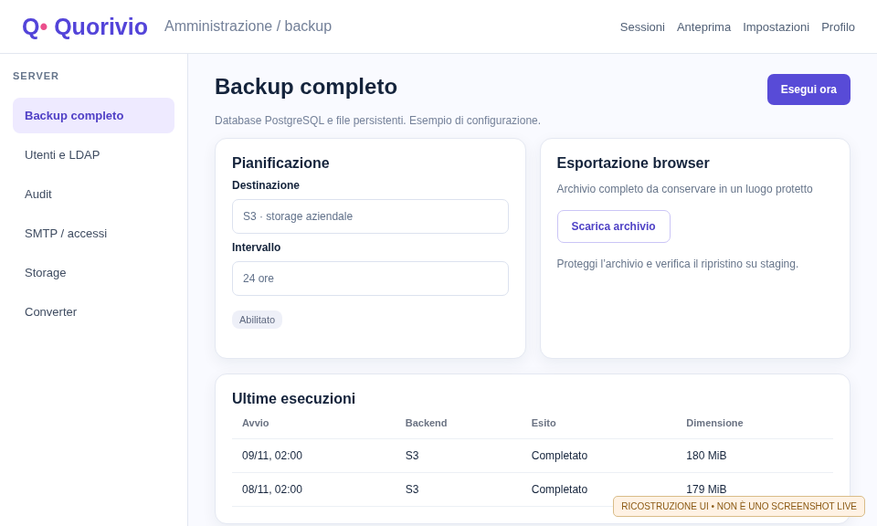
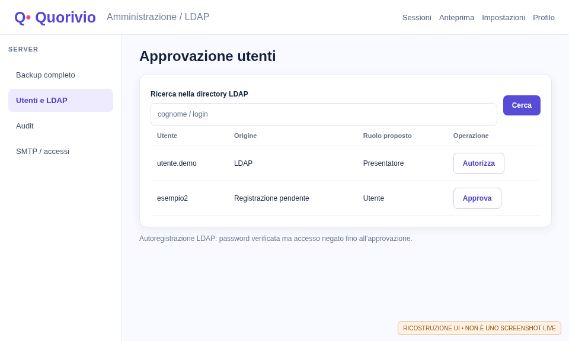
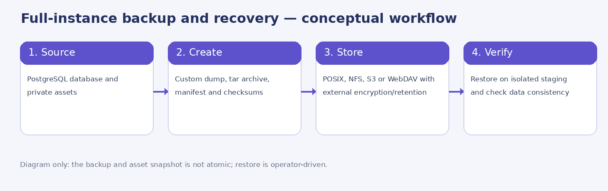
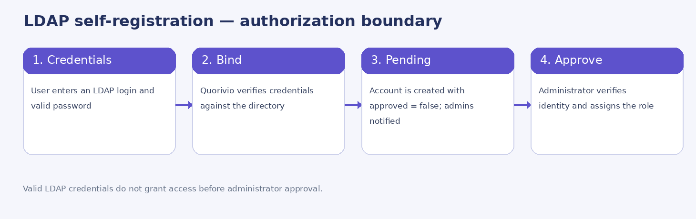

# Manuale dell'amministratore

**Quorivio 0.1.0-dev · Build documentale RC284 · 9 novembre 2026**

Manuale tecnico-operativo per installazione, configurazione, autenticazione, autorizzazioni, backup, monitoraggio, audit, manutenzione e ripristino. Le procedure sono desunte dal sorgente e dai chart della RC284; non costituiscono certificazione di un deployment reale. **Le illustrazioni esplicative presenti nei primi capitoli sono ricostruzioni**, etichettate come tali. La galleria finale, quando presente nel PDF generato dalla CI, contiene esclusivamente screenshot reali dell'istanza temporanea verificati tramite hash e commit; la revisione editoriale D5 resta separata.

## 1. Architettura e responsabilità

Quorivio comprende frontend React/Vite, API Node/Express, PostgreSQL 18 come archivio autorevole, comunicazione live via WebSocket e PostgreSQL LISTEN/NOTIFY, storage persistente per allegati/sfondi/foto, worker isolato per conversione PDF/PPTX e servizio ClamAV per la scansione dei file. Sono disponibili deployment tramite Compose, Helm e wizard Kubernetes. La progettazione a più repliche richiede verifiche specifiche su storage RWX, ingress e sessioni.

| Componente | Funzione | Verifica dell'operatore |
|---|---|---|
| API + frontend | Autenticazione, sessioni, editor, risposte, export | Readiness, HTTPS, versioni coerenti, audit. |
| PostgreSQL 18 | Utenti, sessioni, risposte, configurazioni | Connessioni TLS, backup, migrazioni, spazio, restore. |
| Storage `assets` | Media, sfondi, foto, contenuti | Persistenza, UID/GID, quota, permessi, replica. |
| ClamAV | Controllo sugli upload | Health, firme aggiornate, fail-closed in produzione. |
| Converter | Importazione pagine PDF/PPTX | Worker, token, volume condiviso, limiti, log. |
| Backup | Dump custom PostgreSQL + asset | Volume scratch, destinazione, segreti, retention esterna. |
| SMTP/LDAP/OIDC | Identità e notifiche | TLS, mapping autorizzazioni e credenziali. |

**Modello di responsabilità:** il gestore dell'istanza decide configurazione, basi giuridiche, backup, accessi e risposta agli incidenti. Il proprietario di una sessione governa i propri contenuti; non ha automaticamente privilegi su altre organizzazioni.

## 2. Checklist prima della prima installazione

1. Scegliere il nome DNS pubblico, predisporre certificato TLS valido e record DNS.
2. Definire PostgreSQL interno o esterno e la strategia di aggiornamento delle versioni.
3. Scegliere storage persistente degli asset (RWO per singola replica; RWX supportato dal driver per più repliche).
4. Generare e custodire segreti univoci fuori dal repository Git e dai valori Helm non cifrati.
5. Configurare il primo amministratore di piattaforma e verificare MFA/recupero.
6. Predisporre SMTP, ClamAV e, se utilizzato, LDAP/LDAPS o OAuth/OIDC.
7. Abilitare soltanto i backend di backup effettivamente utilizzabili; eseguire una prova di restore isolata.
8. Verificare ingress HTTPS, log, allarmi disco, retention e ruoli prima di aprire le registrazioni.

**Non mettere in produzione una build `0.1.0-dev` sulla sola base di questo manuale.** La matrice dei gate e gli esiti reali della CI devono essere valutati separatamente.

## 3. Deploy con Docker Compose

Il repository contiene `compose.yaml`, `.env.compose.example`, `.env.example` e il Dockerfile. Preparare un file ambiente **non committato**, distinguere la password di PostgreSQL dalle credenziali dell'account amministratore e montare volumi permanenti per database, `assets` e backup. L'API non deve scrivere su filesystem effimeri per i dati persistenti.

### 3.1 Variabili principali

| Variabile | Significato e attenzione |
|---|---|
| `DATABASE_URL` | Credenziali e endpoint PostgreSQL; usare connessione protetta dove necessario. |
| `PUBLIC_BASE_URL` | URL HTTPS dal quale sono creati link e QR per la partecipazione. |
| `ADMIN_EMAIL`, `ADMIN_PASSWORD` | Bootstrap amministratore; ruotare la password e non divulgarla. |
| `NODE_ENV=production` | Attiva comportamento restrittivo, compresa scansione antivirus obbligatoria. |
| `SMTP_HOST/PORT/SECURE/USER/PASSWORD/FROM` | Invio email e notifiche; `SMTP_SECURE=true` con SMTPS. |
| `QUORIVIO_WORKER_TOKEN` | Token privato robusto per comunicazione con converter isolato. |
| `QUORIVIO_AV_REQUIRED` | Scanner richiesto; in produzione non è una scorciatoia per bypassarlo. |

### 3.2 Prova minima

Verificare che API, DB, ClamAV e converter (se attivo) siano sani; eseguire un login amministratore, creare una sessione di test, inviare una risposta da un secondo browser e osservare i risultati. Conservare i log con accesso limitato: non pubblicare cookie, token, password o payload con dati personali.

## 4. Kubernetes: chart Helm e infrastruttura

Il chart si trova in `helm/quorivio`. Usare un file valori locale separato per l'ambiente e un Secret Kubernetes preesistente per le credenziali. Prima del deploy ispezionare `helm template` e verificare che l'ingress, i mount e le risorse corrispondano al cluster. Helm non installa automaticamente un server NFS o un driver CSI mancante.

### 4.1 Parametri Helm di base

| Parametro | Uso |
|---|---|
| `image.repository`, `image.tag`, `image.pullPolicy` | Immagine applicativa (default `desalvo/quorivio`, tag `latest` sul main). |
| `replicaCount` | Numero di repliche API; valutare disponibilità storage e rete. |
| `existingSecret` | Nome del Secret con credenziali applicative. |
| `publicBaseUrl` | URL pubblico HTTPS. |
| `assets.existingClaim` | PVC già esistente per gli asset. |
| `assets.accessMode`, `assets.size`, `assets.storageClassName` | Accesso e capacità del volume persistente. |
| `ingress.className`, `ingress.host`, `ingress.tlsSecret` | Routing, dominio e terminazione TLS. |
| `antivirus.image` | Immagine ClamAV sidecar. |
| `converter.image` | Worker di conversione isolato. |

### 4.2 Ingress NGINX o HAProxy

Selezionare la classe effettivamente installata. Controllare la compatibilità con ingress NGINX o HAProxy Technologies, incluse eventuali annotazioni legacy specifiche del controller. Allineare il limite massimo dei file tra proxy e backend e verificare i timeout per upload, WebSocket e conversioni lunghe. Un `ingressClassName` corretto non garantisce che un certificato o una porta siano raggiungibili dall'esterno.

### 4.3 Volumi e più repliche

`ReadWriteOnce` non garantisce accesso concorrente da pod su nodi diversi; per gli asset condivisi usare un backend **ReadWriteMany reale**. Testare UID, permessi, lock e allineamento delle istanze. Verificare anche graceful shutdown, migrazioni simultanee e riconnessioni WebSocket dopo lo spostamento di un pod. Non aumentare `replicaCount` prima di validare questi prerequisiti.

## 5. Wizard Kubernetes standalone

`tools/k8s_wizard.py` guida la creazione di manifest per deploy nuovi o revisionati; supporta configurazione di DB, ingress, storage, converter, LDAP e backup. I file di override con credenziali e i Secret generati **non devono essere committati**. Per cluster già installati, generare in una directory separata, confrontare con i manifest realmente applicati e preservare personalizzazioni del converter e delle risorse esistenti.

Esempio di avvio non interattivo, con dati non sensibili:

```bash
python3 tools/k8s_wizard.py --no-self-update --unattended \
  --output ./k8s-generated \
  --set host=quorivio.example.org
kubectl kustomize ./k8s-generated > /tmp/quorivio-rendered.yaml
```

Non aggiungere `ldap_bind_password`, chiavi S3 o token API alla cronologia della shell. Per la rotazione dei segreti, seguire un processo controllato di aggiornamento e restart. Verificare `kubectl diff` e possibilità di rollback prima di applicare il nuovo manifest.

## 6. PostgreSQL 18: configurazione, migrazioni e integrità

PostgreSQL conserva le identità, il modello delle sessioni, le risposte e le configurazioni di backup/audit. Usare `pg_dump`/`pg_restore` compatibili con la versione server. L'aggiornamento della major version non consiste nel sostituire l'immagine container: pianificare migrazione, downtime, backup e rollback secondo le procedure ufficiali di PostgreSQL.

Per DB esterno: controllare server, porta, `DATABASE_URL`, certificati e validazione TLS, autenticazione, ruoli SQL con privilegi minimi, disponibilità e latenza. Non disabilitare la verifica della CA solo per eliminare un errore di handshake. Per installazioni con database interno, dimensionare PVC e monitorare WAL, tabelle, indici e risorse.

Le migrazioni di schema vanno provate su una copia coerente dell'ambiente di produzione. Una migrazione riuscita non garantisce che i file asset siano sincronizzati: eseguire una verifica funzionale end-to-end.

## 7. Backup completo dell'istanza

La RC270 ha introdotto l'**export amministrativo completo**: dump PostgreSQL formato custom, file persistenti degli asset, manifest e checksum SHA-256 in archivio compresso. Dal pannello **Configurazione server → Backup completo** un amministratore può avviare un backup o scaricare il file con il browser. L'archivio contiene informazioni sensibili; cifrarlo e proteggerlo immediatamente secondo la politica dell'organizzazione.

<figure><figcaption>Figura 1 — Ricostruzione illustrativa del pannello backup: destinazione, intervallo, esecuzione manuale, download browser e storico.</figcaption></figure>

### 7.1 Destinazioni e schedule

È configurabile **una destinazione attiva** per on-demand e schedule, con intervallo **1–720 ore**. Lo storico visualizza le ultime esecuzioni; un coordinamento nel DB evita che più repliche reclamino contemporaneamente lo stesso turno. Il download browser è distinto dal target remoto salvato.

| Backend | Parametri operativi | Prerequisiti e rischi |
|---|---|---|
| **POSIX** | Directory relativa al mount previsto | Volume scrivibile nel pod; PVC/permessi/quotazione. |
| **NFS** | PVC esistente oppure host/export NFS montato nel pod | Permessi UID 1000, rete fra nodi ed export, RWX se necessario. |
| **S3 compatibile** | Endpoint HTTPS, bucket, regione/credenziali | SigV4, multipart, policy IAM minima, TLS e lifecycle bucket. |
| **WebDAV** | URL HTTPS, username/password, destinazione | HTTPS valido, permessi di scrittura, server remoto e policy quota. |

### 7.2 Esecuzione manuale e download

Aprire Backup completo, configurare una destinazione abilitata, verificare il suo stato e avviare **Esegui ora**. Attendere che lo storico passi a successo; un codice job creato non significa backup completato. Per il download browser usare l'azione di export completo protetta da autenticazione amministrativa. Verificare `manifest.json`, checksum e leggibilità dell'archivio prima di dichiararlo valido.

### 7.3 Programmazione e controllo esecuzioni

Abilitare la pianificazione e impostare l'intervallo, tenendo conto delle dimensioni del DB e dello storage temporaneo. Controllare periodicamente stato, timestamp, dimensioni, errori e data del test di restore. Un backup con stato «successo» ma mai ripristinato non è una prova di recuperabilità. Non sovrapporre una policy di retention database alla retention delle copie remote.

## 8. Helm: dettagli dei backend di backup

Il chart espone i seguenti gruppi. Gli **interruttori di backend** e i mount sono configurazione di deployment; gli amministratori possono poi gestire destinazione e schedule nella UI se il backend è autorizzato.

| Percorso valori | Descrizione |
|---|---|
| `backup.allowedBackends` | Elenco backend remoti permessi, inizialmente S3/WebDAV. |
| `backup.tmpSize` | Volume scratch per dump e archivio compresso (`/tmp`). |
| `backup.posix.enabled` | Abilitazione mount POSIX. |
| `backup.posix.existingClaim` | PVC POSIX già gestito dal cluster. |
| `backup.posix.accessMode/size/storageClassName` | Creazione nuovo claim, classe e accesso. |
| `backup.nfs.enabled` | Abilitazione destinazione NFS. |
| `backup.nfs.existingClaim` | NFS attraverso PVC già disponibile. |
| `backup.nfs.server`, `backup.nfs.path` | Mount NFS diretto: host server e percorso export. |
| `backup.bootstrap.enabled` | Import iniziale di destinazione, solo se non esiste già. |
| `backup.bootstrap.intervalHours` | Intervallo iniziale dello scheduler. |
| `backup.bootstrap.existingSecret` | Secret che contiene `BACKUP_TARGET_JSON`. |

**Esempio non contenente credenziali:**

```yaml
backup:
  tmpSize: 20Gi
  allowedBackends: [s3, webdav]
  posix:
    enabled: true
    existingClaim: quorivio-backups
  nfs:
    enabled: false
  bootstrap:
    enabled: false
```

Per NFS con mount diretto impostare `backup.nfs.server` e `backup.nfs.path` e verificare che il mount sia realmente disponibile e scrivibile nel pod. `backup.tmpSize` deve coprire il dump e l'archivio durante la stessa esecuzione; un `emptyDir` su disco può riempire il filesystem del nodo.

### 8.1 Secret e cifratura

Il bootstrap remoto deve ricevere le credenziali dal **Secret Kubernetes** (chiave `BACKUP_TARGET_JSON`), non da valori Helm in chiaro. Una volta importata, la configurazione viene cifrata a livello applicativo con AES-256-GCM e chiave derivata dal segreto di autenticazione. La cifratura applicativa non sostituisce il controllo accessi del cluster, la cifratura a riposo dei volumi o la protezione dei backup stessi.

## 9. Ripristino e disaster recovery

**Il ripristino completo resta offline e manuale**, non è un pulsante della dashboard. Va eseguito su staging prima di qualunque tentativo produttivo.

1. Conservare una copia dell'ambiente sorgente e sospendere le scritture o coordinare snapshot consistenti di database e asset.
2. Scaricare l'archivio da storage sicuro e verificarne manifest, SHA-256 e contenuti.
3. Preparare una nuova istanza isolata, DB PostgreSQL vuoto e volume asset vuoto; definire il piano per utenti, permessi e credenziali.
4. Estrarre il dump e la directory asset in un ambiente protetto; usare `pg_restore` compatibile con PostgreSQL 18 per il database target, senza sovrascrivere un'istanza attiva.
5. Ripristinare la directory degli asset con proprietario/permissi corretti, poi avviare i servizi e controllare schema, riferimenti ai file, login, sessioni, risultati e API.
6. Misurare tempo di ripristino e perdita dati rispetto a RTO/RPO richiesti. Documentare il risultato, i difetti e le azioni correttive.

**Limiti da riportare nel piano DR:** il dump del database e il salvataggio asset non costituiscono uno snapshot atomico simultaneo; retention automatica degli archivi remoti e pianificazioni multiple non sono implementate. Cifratura dell'archivio e lifecycle dello storage richiedono controlli esterni. Non eseguire `pg_restore --clean` su un DB produttivo senza prova, approvazione e rollback.

## 10. Identità locali, registrazione e approvazione

L'amministratore gestisce gli utenti da **Impostazioni server / gestione utenti**. Un nuovo utente locale o LDAP può registrarsi, ma resta **pendente** fino all'approvazione di un amministratore autorizzato. Un account pendente non accede solo perché possiede credenziali valide. Scegliere il ruolo più limitato (utente o presentatore) necessario; concedere privilegi di amministratore solo attraverso una procedura esplicita e verificata.

Se SMTP è configurato, la nuova richiesta genera una notifica agli amministratori di piattaforma approvati. In caso di posta non configurata l'account resta comunque pendente: utilizzare il pannello amministrativo come fonte autorevole per le richieste da esaminare.

## 11. LDAP/LDAPS e Active Directory

### 11.1 Configurazione tecnica

La directory è opzionale. Il service bind permette ricerche controllate; il login verifica la password attraverso un bind dell'utente. Preferire `ldaps://` con validazione del certificato o `ldap://` con STARTTLS. Configurare filtro `uid={login}` o mapping AD, attributo identificativo stabile e base DN corretta. Non collegare automaticamente due account che condividono solo l'email.

| Parametro wizard | Significato |
|---|---|
| `ldap_enabled`, `ldap_url` | Attivazione e URL LDAP/LDAPS. |
| `ldap_bind_dn`, `ldap_bind_password` | Identità service bind e segreto. |
| `ldap_base_dn`, `ldap_user_filter` | Base e filtro di ricerca con placeholder `{login}`. |
| `ldap_id_attribute` | Identificatore stabile (`entryUUID` o `objectGUID`). |
| `ldap_email_attribute`, `ldap_group_attribute` | Attributi email e appartenenza ai gruppi. |
| `ldap_admin_group_dn`, `ldap_presenter_group_dn` | Mapping gruppi, non sostituisce approvazione Quorivio. |
| `ldap_auto_provision`, `ldap_organization_id` | Creazione di account pendenti e organizzazione di riferimento. |
| `ldap_starttls`, `ldap_tls_ca_file` | TLS e CA aziendale da montare nel container. |

### 11.2 Autoregistrazione LDAP

L'utente immette login e password LDAP; il server effettua un bind sicuro e crea l'identità collegata con `approved=false`. L'amministratore riceve la notifica quando la posta funziona, controlla la richiesta e approva o rifiuta. I gruppi LDAP non devono promuovere automaticamente ruoli amministrativi dopo la decisione di Quorivio.

### 11.3 Creazione amministrativa da ricerca LDAP

In gestione utenti selezionare **Cerca nella directory**, cercare per login/nome con le autorizzazioni del service bind, identificare l'utente giusto tramite ID stabile, scegliere il ruolo e inserirlo tra gli utenti autorizzati. Se l'identità è già collegata, il sistema non deve duplicarla o ricollegarla automaticamente. Registrare le decisioni nell'audit.

<figure><figcaption>Figura 2 — Esempio illustrativo della ricerca directory e approvazione di account; non contiene dati LDAP reali.</figcaption></figure>

## 12. SMTP, OAuth/OIDC e MFA

SMTP serve per richieste di approvazione, recupero credenziali e notifiche operative. Configurare host, porta, TLS, indirizzo mittente e autenticazione; provare recapito effettivo e gestione degli errori, senza registrare password nei log.

**Stato di autorizzazione tra repliche (sicurezza e HA).** Lo stato OAuth è conservato in PostgreSQL e consumato una sola volta tra tutte le repliche. Per OIDC e OAuth social il server inserisce nella tabella `auth_flows` esclusivamente l’hash dello `state` casuale, il provider e una scadenza di cinque minuti. Al callback il record è consumato atomicamente con `DELETE FROM auth_flows ... RETURNING`: si verificano anche il cookie di stato del browser e il provider e si rifiutano stati scaduti, mancanti o già utilizzati. **Lo stato non deve essere custodito soltanto nella memoria di un processo**, perché l’ingress può inviare il callback a un’altra replica. Durante una prova di rolling restart/failover verificare che una richiesta OAuth/OIDC iniziata su una replica possa terminare su un’altra e che il riutilizzo del medesimo callback venga rifiutato. Tutte le repliche devono raggiungere PostgreSQL; mantenere HTTPS e cookie sicuri e non registrare codici, segreti o valori di stato nei log. Questo è un contratto del software, non una certificazione dei provider esterni.

OAuth/OIDC può usare provider configurati come Google, GitHub, Facebook o provider generici, con callback HTTPS e segreti specifici. Verificare `state`, redirect URI e collegamento esplicito dell'identità: la coincidenza della mail non è un proof-of-ownership. MFA TOTP e codici di recupero vanno gestiti secondo la policy dell'istanza. I reset MFA amministrativi richiedono autorizzazione forte e revoca delle sessioni pertinenti.

## 13. Audit delle operazioni e retention

Il registro audit conserva evento, attore, timestamp, azione, risorsa e stato senza memorizzare password, cookie, token, IP o contenuto integrale delle risposte. Gli amministratori possono ricercare per utente, risorsa/UUID e azione, consultare le pagine e impostare retention **7–3650 giorni**.

Il **purge manuale** elimina gli eventi più vecchi della soglia scelta; il job automatico esegue la stessa politica periodicamente. Prima di abbreviare la retention, confrontarla con obblighi legali, politica di incident response e log esterni. L'audit non sostituisce un SIEM né prova da solo la conformità GDPR.

## 14. Altre impostazioni avanzate del server

| Area | Operazioni principali | Validazione consigliata |
|---|---|---|
| URL pubblico e QR | Cambiare `PUBLIC_BASE_URL`/impostazione server | Rigenerare QR esportati, provare inviti vecchi e nuovi. |
| Converter PDF/PPTX | Abilitazione worker, immagine, token, shared volume | Importazione reale; controllo errori 413/415/503 e cleanup. |
| ClamAV | Sidecar e policy di scansione | File benigno e campione EICAR in ambiente di test; fail closed. |
| Storage | PVC, quote, stato mount e cleanup | Simulare esaurimento spazio e verificare allarmi. |
| Email | SMTP, mittente, TLS e notifiche | Recapito e mancato recapito, approvazioni pendenti. |
| Profili | Fotografie, Gravatar, sovrascrittura file | Origine HTTPS, licenze, diritto all'immagine e permessi. |
| Utenti | Approvazione, ruolo, revoca, collegamento esterno | Controllare sessioni attive e privilegi residui. |
| Backup | Target, schedule, storico ed export | Restore isolato, verifica integrità, segreti e retention. |

## 15. Monitoraggio, performance e alta disponibilità

Controllare endpoint `/api/health/live` e `/api/health/ready`, salute PostgreSQL, occupazione di asset e conversione, capacità del nodo, disponibilità degli ingress e delle repliche. La dimensione logica `pg_database_size` non rappresenta tutti i file fisici PostgreSQL (per esempio WAL): non usarla come soglia disco esclusiva.

Il sistema può inviare allarmi su soglie di utilizzo dello storage agli amministratori, se SMTP è operativo. Testare esplicitamente comportamento in multi-pod, perdita di una replica, ripartenza del converter e rinnovo dei certificati. Per test di carico, utilizzare l'harness previsto dal progetto senza considerare un test di laboratorio come garanzia per il traffico reale.

## 16. Sicurezza e GDPR by design

Configurare HTTPS end-to-end, Secret protetti, segregazione organizzativa e privilegi minimi, sessioni protette, audit e retention coerenti. Disabilitare credenziali demo e provider non utilizzati. Gli allegati devono passare dai controlli di scansione; non forzare la disattivazione dell'antivirus in produzione. Riesaminare policy di backup con dati personali e procedure di cancellazione.

Il titolare del trattamento deve predisporre informativa, base giuridica, tempi di conservazione, eventuale DPIA, contratti con responsabili/subprocessori e canali per esercizio dei diritti. I controlli del software sono strumenti, **non una certificazione GDPR o AgID**. Aggiornare periodicamente dipendenze e analizzare risultati `npm audit`, Trivy e dei test security.

**Prova di carico autorizzata con 500 partecipanti (solo staging).** Utilizzare `tools/live_500_answers.py` esclusivamente su un'istanza amministrata e per cui si è ottenuta un'autorizzazione esplicita al carico. Prerequisiti: sessione demo dedicata del presentatore, cookie di autenticazione fornito solo tramite `QUORIVIO_LOAD_PRESENTER_COOKIE`, risorse sufficienti, finestra concordata e piano di ripristino. La CLI richiede `--base-url`, `--confirm-host` esattamente uguale al nome host e `--confirm-run`; fuori da loopback è obbligatorio HTTPS. `--open-test-question` può aprire la domanda demo designata. L'opzione distruttiva `--reset-before` è consentita **solo insieme a** `--open-test-question`: azzera i voti demo precedenti e ruota l'invito, perciò non va usata con dati reali dei partecipanti. Esempio controllato:

```bash
# Eseguire solo sullo staging autorizzato; il cookie non va mai incollato qui.
python3 tools/live_500_answers.py --base-url https://staging.example.org \
  --confirm-host staging.example.org --confirm-run --users 500 \
  --open-test-question --ramp-seconds 900 --json-out load-summary.json
```

Accettare il risultato soltanto se le risposte confermate dal server sono effettivamente 500; verificare anche contatore del presentatore, latenza ed errori. Le sole richieste HTTP tentate non dimostrano voti accettati. Lo strumento `tools/load_500.py` verifica separatamente la contemporaneità delle connessioni WebSocket. Conservare esclusivamente report aggregati privi di credenziali, token di accesso, nomi o identificativi di sessione. Le foto Gravatar seguono le politiche di autorizzazione, retention e diritti d'immagine: non usare fotografie reali in prove sintetiche.

## 17. Aggiornamenti, CI e pubblicazione immagini

Il main usa il tag container **`latest`**; le release taggate usano il nome del tag. La pubblicazione dell'immagine è separata dal solo build/test e dipende dai gate CI e dalle autorizzazioni del workflow. Non pubblicare nuove immagini, eseguire commit, push o tag senza procedura di change management.

Per aggiornare: creare un backup verificato, riprodurre la CI con lockfile deterministico (`npm ci`), riesaminare modifiche Helm/migrazioni, testare staging, preparare rollback e solo poi aggiornare le repliche. Inventari SHA-256 storici devono restare immutabili, mentre ogni ciclo nuovo deve produrre il proprio manifest coerente con i file realmente committati.

## 18. Troubleshooting amministrativo

| Problema | Possibile causa | Azione protetta |
|---|---|---|
| Login LDAP non riesce | Certificato, base DN, filtro, bind user o approvazione | Verificare TLS, query e stato utente senza registrare password. |
| Notifica amministratori assente | SMTP non configurato o fallimento consegna | Esaminare log riservati e la coda di account pendenti. |
| Backup fallito | Credenziali, quota, rete, mount read-only o scratch pieno | Verificare stato run, permessi e policy storage; ritestare. |
| Restore incompleto | DB e asset non coordinati | Ripartire da target vuoto e archivio validato su staging. |
| Converter 503 | Worker non operativo/configurato | Health worker, token, mount condiviso e pod logs. |
| Upload bloccati | ClamAV assente o scansione fallita | Ripristinare il servizio scanner, non bypassarlo. |
| Risultati non propagati | WebSocket/DB/ingress o evento non registrato | Controllare LISTEN/NOTIFY, connessioni e attività. |
| Grafici disallineati | Widget sorgente errato o opzioni modificate | Verificare IDs e stato delle domande, non alterare voti storici. |
| CI fallisce inventario | File mutato dopo generazione manifest | Confrontare lockfile e SHA-256 prima dell'installazione, usare `npm ci`. |

## 19. Piano di accettazione operativa

- [ ] Immagini e tag applicativi registrati e coerenti su tutte le repliche.
- [ ] Ingress HTTPS, WebSocket, DNS e certificati validati da esterno.
- [ ] PostgreSQL 18 provato con migrazioni e recovery, non solo con readiness.
- [ ] ClamAV attivo in modalità fail-closed e worker di conversione testato.
- [ ] Registrazione locale/LDAP, approvazione e notifiche SMTP provate davvero.
- [ ] Ruoli amministratore/presentatore/utente isolati e sessioni revocate quando necessario.
- [ ] Backup POSIX/NFS/S3/WebDAV realmente utilizzati: integrità, retention esterna, restore verificato.
- [ ] Pannello audit, ricerca, cancellazione e retention automatica verificati.
- [ ] Anteprima, editor e sessioni reali provati da desktop e smartphone.
- [ ] Privacy, hardening, scansioni e incident response revisionati da responsabili competenti.

## 20. Riferimenti tecnici, glossario e stato

**Fonti repository:** `helm/quorivio/values.yaml`, `tools/k8s_wizard.py`, `apps/api/src/schema.sql`, `apps/api/src/server.ts`, `docs/RC_CYCLE270_FULL_BACKUP_LDAP_AUDIT_RESULTS.it.md`, `docs/RC_CYCLE269_LDAP_OWNERSHIP_HOUSEKEEPING.it.md`, `docs/SECURITY.it.md`, `docs/DEVELOPMENT_STATUS.it.md`.

**PVC:** PersistentVolumeClaim. **RWX:** volume accessibile in scrittura da più nodi/pod secondo il driver. **RPO/RTO:** obiettivi di perdita dati e ripristino. **LDAP bind:** autenticazione contro la directory. **MFA:** secondo fattore. **SigV4:** firma compatibile con API S3. **Fail closed:** rifiuto della funzionalità quando una protezione necessaria non è disponibile. **Drill:** prova controllata di disaster recovery.

**Limiti attuali:** restore automatico, schedule multiple, retention degli archivi remoti e collaudi integrati reali di tutti i provider non sono dichiarati completati. Il punteggio del progetto resta **85,25%** finché i gate non vengono certificati. Le illustrazioni non costituiscono prova visiva del software in funzione.

## Appendice A. Matrice di decisione per lo storage di backup

Prima di scegliere un backend, raccogliere dimensione del database e degli asset, frequenza desiderata, costi di trasferimento, disponibilità dello storage e obblighi di cifratura e retention. Il volume di lavoro temporaneo deve essere dimensionato per una copia compressa e per i file intermedi. In una produzione a più pod, un backup manuale deve essere eseguito da un'unica istanza alla volta.

| Requisito | POSIX/PVC | NFS | S3 | WebDAV |
|---|---|---|---|---|
| Disponibile come mount locale nel pod | Sì | Sì | No | No |
| Dipende da rete remota applicativa | Secondo lo storage CSI | Sì | Sì | Sì |
| Supporto tipico a lifecycle automatico | Da gestire esternamente | Da gestire sul server | Possibile nel bucket | Dipende dal server |
| Credenziali API nel target Quorivio | No | Di norma no, mount esterno | Sì | Sì |
| Verifica di ripristino da effettuare | Database + asset | Database + asset | Database + asset | Database + asset |

<figure><figcaption>Figura 3 — Flusso concettuale del backup. L'archivio non rappresenta uno snapshot atomico DB+asset e il ripristino è manuale.</figcaption></figure>

## Appendice B. Procedura di backup: prova mensile obbligatoria

1. Accedere come amministratore autorizzato e leggere lo storico delle ultime esecuzioni.
2. Verificare la destinazione: permessi di scrittura, spazio, scadenza credenziali, raggiungibilità e policy di versioning.
3. Avviare un backup manuale; attendere lo stato finale, non fermarsi alla risposta HTTP di accettazione.
4. Leggere dimensione e checksum e confrontare la presenza dell'archivio sullo storage destinazione.
5. Riprodurre il restore su una nuova istanza di staging senza scritture concorrenti.
6. Confrontare una sessione campione con i relativi media, login e risultati; annotare tempi, errori e responsabile.
7. Ripetere al mutare della struttura DB, delle classi di storage o delle versioni principali.

È opportuno mantenere un registro dei drill indipendente dal database Quorivio, perché proprio il database può risultare indisponibile durante il ripristino.

## Appendice C. Configurazioni NFS e S3: esempi di controllo

Un volume NFS montato direttamente richiede un server e un export raggiungibile dai worker Kubernetes; il server deve consentire l'accesso all'identità effettiva del processo applicativo. Esempio di sezione **non segreta** per Helm:

```yaml
backup:
  nfs:
    enabled: true
    server: nfs.example.org
    path: /exports/quorivio-backups
  posix:
    enabled: false
```

Per S3 configurare `backup.allowedBackends` includendo `s3`, quindi inserire endpoint, bucket, regione e credenziali nel pannello autorizzato o mediante Secret bootstrap. La policy IAM dovrebbe consentire soltanto gli oggetti del prefisso di backup richiesto. Testare operazioni multipart e gestione dei caricamenti interrotti. La rotazione della chiave non può dipendere da un utente personale lasciato attivo indefinitamente.

## Appendice D. Workflow LDAP: dalla password valida all'accesso approvato

1. Il richiedente sceglie autoregistrazione LDAP e inserisce login e password.
2. La connessione usa LDAPS o STARTTLS con certificato validato; il server ricerca l'identità e verifica le credenziali con bind dell'utente.
3. L'account viene associato all'identificatore di directory stabile, con `approved=false`, anche se la password è corretta.
4. Gli amministratori ricevono una mail quando SMTP funziona; l'account rimane visibile nel pannello delle richieste.
5. Un amministratore confronta identità e ruolo richiesto con la policy dell'organizzazione.
6. Solo dopo l'approvazione l'utente può entrare con LDAP; cambiamenti del gruppo non sostituiscono la decisione locale.

<figure><figcaption>Figura 4 — Flusso di autorizzazione. Credenziali LDAP valide non equivalgono a un account Quorivio approvato.</figcaption></figure>

## Appendice E. Flusso di audit, ricerca e cancellazione

Aprire **Configurazione server → Audit**, filtrare per utente, azione o risorsa e limitare l'intervallo temporale. Per un incidente di autorizzazione cercare il soggetto e le operazioni pertinenti, conservando solo gli estratti necessari secondo la policy legale. Impostare la retention approvata dall'organizzazione tra 7 e 3650 giorni; prima di usare il purge manuale verificare obblighi di conservazione, eventuali indagini in corso e backup dei log.

**Esempio di controllo:** effettuare una modifica di un'impostazione server con un amministratore di prova, poi ricercare timestamp, attore, rotta normalizzata e stato HTTP nell'audit. Verificare che credenziali, corpo della richiesta, cookie e contenuto delle risposte degli utenti non siano registrati. Ridurre la retention richiede attenzione perché la cancellazione può essere irreversibile.

## Appendice F. Ciclo di vita delle credenziali

Conservare token e password in Secret Kubernetes o secret manager: mai nel repository, negli artefatti pubblici di CI, nei manifest di esempio o nella shell history. Predisporre un registro di rotazione con tipo di segreto, proprietario, prossima scadenza e impatto del cambio. Per credenziali S3/WebDAV verificare la destinazione di backup subito dopo la rotazione; per le chiavi di cifratura applicativa, documentare come un segreto storico possa essere necessario per leggere una configurazione già cifrata.

In caso di compromissione revocare credenziali e sessioni, esaminare gli audit pertinenti, preservare evidenze minime e attivare il processo di incident response. Non risolvere una criticità rendendo pubblici i log o disabilitando la verifica TLS.

## Appendice G. Accettazione multi-replica con ingress reali

Un test ripetibile deve includere almeno due repliche su nodi compatibili con lo storage RWX, ingresso HTTPS, sessione avviata, partecipante connesso tramite WebSocket e risposta inviata durante lo spegnimento controllato di una replica. Controllare che i risultati convergano, che il client possa riconnettersi e che i file allegati rimangano leggibili. Ripetere la prova sia con NGINX sia con HAProxy se entrambi sono dichiarati supportati per l'installazione.

Non confondere la validazione dello schema dei manifest con una prova di funzionamento del cluster. Gli oggetti Kubernetes possono essere sintatticamente corretti ma fallire per CSI assente, export NFS irraggiungibile, certificato errato o permessi insufficienti.

## Appendice H. Piano di change management per una nuova RC

Per ogni cumulativo: ricostruire dai sorgenti integri, registrare le modifiche dopo l'ultimo commit, generare la nuova documentazione, aggiornare gli inventari SHA-256, verificare che le copie pubbliche dei manuali corrispondano, eseguire preflight e controlli TypeScript, poi full CI. Distinguere **gate superati localmente**, **gate superati in GitHub Actions** e **prove reali su infrastruttura**.

Dopo una CI fallita leggere il **primo step fallito**, non limitarsi al job di riepilogo; non disabilitare test per ottenere un risultato verde. Un nuovo ciclo di documentazione non certifica le funzioni che illustra: una screenshot simulata non equivale a prova real-browser.


## Appendice I. Schermate autentiche e riferimenti rapidi

La galleria mostra soltanto acquisizioni genuine da un Quorivio avviato in CI, con database e identità di prova. Le schermate sono correlate al commit con SHA-256. Non derivano da composizioni illustrate. Le schermate sono una guida all’uso, non prove di certificazione funzionale o di sicurezza.

<!-- REAL_SCREENSHOT_GALLERY -->

Nota editoriale: riscrittura iniziale in RC277; revisione metadati e processo schermate RC278.

## Appendice L. Scaling orizzontale: procedura Kubernetes verificabile

**Prerequisiti:** due o più nodi schedulabili, driver CSI con RWX effettivo per `assets`, connettività TCP al DB condiviso, ingress con WebSocket e storage backup coerente. La dichiarazione `ReadWriteMany` in Helm **non crea** una classe RWX: occorre verificarne capacità e permessi sul cluster. L'installazione con singolo nodo e PVC RWO non è sufficiente per qualificare l'alta disponibilità.

1. Prendere un backup completo e verificare restore su ambiente separato; annotare commit, tag immagine, stato migratorio e SHA-256 del backup.
2. Misurare utilizzo medio e di picco: CPU/RAM API, ClamAV e converter, numero di WebSocket, latenza p95, DB connessioni, spazio asset e scratch.
3. Predisporre lo storage condiviso reale, verificando con pod di prova scrittura su un nodo e lettura da un altro.
4. Salvare un file valori di staging, ad esempio:

```yaml
replicaCount: 2
enforceNodeDiversity: true
assets:
  existingClaim: quorivio-assets-rwx
  accessMode: ReadWriteMany
backup:
  allowedBackends: [s3, webdav]
  posix:
    enabled: false
```

5. Eseguire `helm template quorivio ./helm/quorivio -f values-staging.yaml` e ispezionare i manifest; quindi `helm upgrade --install quorivio ./helm/quorivio -n quorivio -f values-staging.yaml` solo dopo revisione dei segreti, service account e storage.
6. Usare `kubectl -n quorivio rollout status deployment/quorivio-quorivio` e `kubectl -n quorivio get pods -o wide` per verificare che le repliche siano distribuite come previsto. Controllare PodDisruptionBudget, readiness, `terminationGracePeriodSeconds` e rinnovi WebSocket.
7. Avviare una prova con due browser, sessione live e una risposta in corso; dismettere un pod controllatamente e misurare reconnessione, accesso ai file, continuità dei risultati e durata del ripristino. Tornare a una replica se lo storage, il networking o le performance non sono conformi.

**HPA:** un autoscaler deve essere introdotto soltanto dopo benchmark e limiti sulle connessioni PostgreSQL. Il chart attuale espone `replicaCount` e risorse, ma non costituisce da solo una policy HPA verificata. Per produzioni con grandi sessioni, prevedere pool di connessioni, protezione anti-thundering herd, test di churn WebSocket, soglie di allarme e un capacity plan. I valori `resources.requests` del chart sono parametri iniziali, non requisiti hardware certificati.

## Appendice M. Disaster Recovery: runbook con obiettivi di ripristino

| Fase | Azione operativa | Evidenza di accettazione |
|---|---|---|
| Preparazione | Definire RPO, RTO, proprietario incident, ultima copia integra e segreti richiesti | Registro DR e ultimo test superato |
| Contenimento | Bloccare scritture e rotte pubbliche sul sito guasto, preservando audit minimi | Data/ora disconnessione e incident ticket |
| Ricostruzione | Creare nuovo PostgreSQL 18, storage `assets`, servizi e secret manager separati | Configurazione equivalente ma senza riuso di credenziali compromesse |
| Restore DB | Recuperare archivio, verificare SHA-256 e usare `pg_restore` su database **vuoto** in staging | Tabelle, utenti, sessioni e risposte campione coerenti |
| Restore file | Ricostruire gerarchie `assets` e permessi senza sovrascrivere file estranei | Media, sfondi, foto e PDF campione leggibili |
| Riattivazione | Testare API, login MFA/LDAP, editor, QR, WebSocket, ClamAV, converter e backup | Checklist firmata e test dal browser |
| Failback | Riportare il traffico al primario soltanto con piano condiviso e nuova prova | RTO e perdita dati reali misurati contro gli obiettivi |

**Attenzione:** esportazione DB e asset avvengono in fasi diverse. L'archivio completo non è uno snapshot perfettamente atomico e può richiedere riconciliazione. Conservare backup off-site con cifratura e lifecycle gestiti fuori da Quorivio; la configurazione applicativa cifrata può richiedere lo storico della chiave originale, custodito in modo indipendente dai backup. La procedura deve essere collaudata **senza** dati reali e senza sostituire dati produttivi.

**Esempio prudenziale di verifica:** controllare che `pg_restore --list dump.backup` elenchi gli oggetti attesi prima di procedere. Per il ripristino applicare `pg_restore --no-owner --no-privileges --dbname=quorivio_test dump.backup` a un database vuoto e poi eseguire query di controllo coerenti con lo schema. Non applicare opzioni distruttive a un'istanza di produzione.

## Scheda tecnica di compatibilità e requisiti indicativi

| Ambito | Piattaforme utilizzabili | Risorse **indicative**, da validare |
|---|---|---|
| Server standalone/laboratorio | Linux amd64/arm64 con container Docker o Podman, PostgreSQL 18 | 2 vCPU, 4 GiB RAM, 20 GiB disco di sistema **oltre** ai volumi di database, media e backup |
| Server Kubernetes/HA | Linux su più nodi Kubernetes, ingress NGINX/HAProxy, storage RWX reale | Almeno 2 nodi distinti per test HA; considerare 4 vCPU/8 GiB per nodo come punto di partenza da misurare |
| Browser desktop | Chrome/Chromium, Firefox, Edge e Safari aggiornati su Windows/macOS/Linux | CPU recente, circa 2 GiB RAM liberi per il browser, display adeguato; la proiezione richiede maggiore risoluzione |
| Browser smartphone/tablet | Browser aggiornati su Android/iOS/iPadOS | Circa 2 GiB RAM disponibili e viewport di almeno 360 CSS px raccomandati; Wi-Fi/dati stabili |

I valori sono **ipotesi prudenziali per pianificare i test**, non minimi ufficialmente certificati da benchmark. Per un evento con molti partecipanti servono prove di carico con numero utenti, quantità di media, simultaneità delle risposte e banda misurati. Il requisito minimo può cambiare con antimalware, conversione documenti, importazioni e backup. Per eventuali limitazioni di WebKit/Safari, touch e dispositivi più vecchi, consultare gli esiti reali della matrice CI della stessa build.
