# Presenter guide

**Quorivio 0.1.0-dev · Documentation build RC290 · 9 November 2026**

An end-to-end guide to preparing, designing, rehearsing, conducting, exporting and archiving a Quorivio event. It reflects the RC290 codebase, including answer grading and the green **R** toggle. Earlier illustrative figures are **labelled browser-rendered reconstructions**. The final gallery in CI-built PDFs contains genuine screenshots of the running disposable application, verified against source commit and SHA-256.

## 1. The complete event workflow

A successful event has four phases: **prepare** (account, session, pages and widgets); **rehearse** (desktop/mobile previews and simulated submissions); **deliver** (invitation, page navigation, opening answers and live results); and **close** (exports, data lifecycle, archival). Always test from a second device before inviting real participants.

| Phase | Action | Acceptance check |
|---|---|---|
| Prepare | Create or open a session | Correct approved presenter account and session. |
| Design | Build pages, masters and widgets | No clipped content; mobile view reviewed. |
| Rehearse | Use Presenter, Participant and Side-by-side preview | Answers, charts, grading and QR behave as expected. |
| Deliver | Start the session; control the audience screen | Private administrative controls are never projected. |
| Close | Close collection, export and archive | Retention and collaborators have been checked. |

<figure>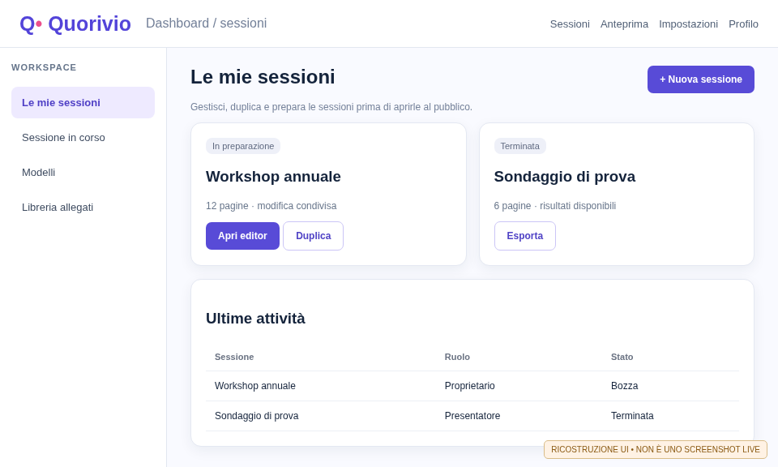<figcaption>Figure 1 — An illustrative session dashboard with draft, duplicate and editor actions.</figcaption></figure>

## 2. Account, login and roles

Presenters must have an approved account. Depending on deployment settings, the login can involve local credentials, LDAP, a linked identity provider or MFA. An administrator assigns account approval and role; email matching or LDAP group membership alone must not grant privileged access. Review your public profile and the rights to any portrait image before an event.

## 3. Managing sessions

### 3.1 Create and open

From the dashboard choose **New session**, enter an informative title, confirm, and open the new workspace. The sidebar lets you switch between sessions. Keep a separate rehearsal copy and use a definition-only duplicate for the final event rather than testing with actual audience responses.

### 3.2 Rename, duplicate, close, reset and delete

Session actions provide the corresponding management operations. **Duplicate** copies definitions but should not copy audience response history. **Delete** is destructive and requires confirmation; check organizational retention and backups first. Authorized reset controls can return a session to a not-started state without opening a live projection.

### 3.3 Ownership and collaboration

Owners can grant approved co-presenters appropriate access. Ownership transfer to another approved presenter in the same organization must be deliberate and auditable; decide whether the original owner retains collaboration rights. Never share a single login to circumvent permission rules.

## 4. Organizing pages

Create a sequence before fine-tuning the layout: introduction, poll, results, discussion, audience Q&A and closing. Use thumbnails and their contextual actions to select multiple pages, reorder, duplicate, rename or delete. Numbering should match what is visible to presenters and participants, including deliberately hidden/skipped pages.

Result widgets may reference questions on other pages. Set the source page, widget and optionally subquestion explicitly, then validate that link in rehearsal after reordering pages.

## 5. The visual editor

The PowerPoint-like editor has a **canvas** with rulers, selection handles, move, resize and rotation operations, alignment guides and contextual formatting. Place widgets inside the canvas boundaries, not into sidebar or palette whitespace. Global editor zoom affects workspace controls rather than authored slide coordinates.

<figure>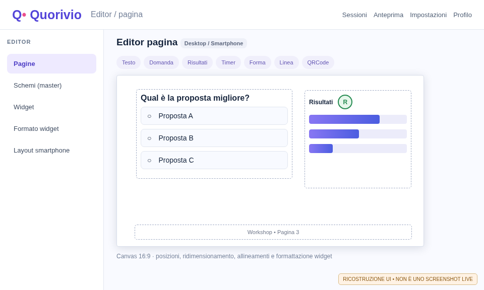<figcaption>Figure 2 — Reconstructed 16:9 editor showing a question, a linked result widget and its R control.</figcaption></figure>

### 5.1 Widget editing and floating dialogs

Choose a widget from the palette, position it on the page and adjust geometry. Double-click supported text to edit it; **Widget properties** manages contents and links, and **Widget formatting** manages typography, colors, borders, effects, visibility and widget-specific controls. Floating property and format panels are movable and resizable.

### 5.2 Keyboard, clipboard and history

Multi-selection, **Cut/Copy/Paste**, **Undo/Redo** and deletion apply to the selected widgets. Arrow keys and modifiers support geometry editing according to the control's shortcuts. Confirm persistence by saving and reopening the session before presenting.

### 5.3 Text formatting and line wrapping

**Arial** is the reference font. Formatting can apply to the whole widget or to selected text. Question titles, descriptions, answer choices and submit buttons have independent typography. Long choices should wrap rather than disappear. Check left/center/right and vertical alignment in editor and preview.

## 6. Slide masters, backgrounds and footers

**Masters** define reusable title, footer, logos and background behavior. Open the master editor from the dashboard, edit the template using familiar page-editor tools and apply it to new pages. Global backgrounds must not silently overwrite an explicit page-level choice. Verify that new pages and previews receive the intended design.

The footer may contain centered session text and a page number with inset padding. Configure separator, typography and alignment. Use the media library to maintain reusable backgrounds, avoiding asset-name collisions and deleting files still referenced by pages.

## 7. Complete widget reference

This list is derived from the page-design schema. Availability in the code does not replace a real browser or accessibility test in your deployment.

| Widget | Purpose | Key settings or behavior |
|---|---|---|
| **Title** (`title`) | Page heading | Text source, master styles, visibility and location. |
| **Footer** (`footer`) | Page number and caption | Divider, padding, alignment and typography. |
| **Text** (`text`) | Rich narrative | Fonts, wrapping, alignment and inline selection. |
| **Sticky note** (`postit`) | Highlight | Fill, typography, size and rotation. |
| **Divider** (`divider`) | Visual separation | Position and geometry. |
| **Shape** (`shape`) | Vector objects | Rectangle, ellipse, arrows, stroke and fill. |
| **Line** (`line`) | Connectors | Direction, dashes, width and arrowheads. |
| **Image** (`image`) | Photo or graphic | Asset, crop, fit and alt text. |
| **Logo** (`logo`) | Branding | Image source and scaling. |
| **Video** (`video`) | Embedded media | Controls and mobile playback. |
| **PDF** (`pdf`) | Document material | Imported/rendered page representation. |
| **QR** (`qr`) | Audience invitation | Current URL, auto-refresh and single-line readability. |
| **Profile** (`profile`) | Presenter identity | Photo, description and optional public email. |
| **Question** (`question`) | Single/multiple/text/file | Options, required flag, subquestions and answer key. |
| **Timed quiz** (`timed-quiz`) | Deadline-based answer | Duration, grading, submission and timer. |
| **Topic question** (`topic-question`) | Audience Q&A | Input box, review and moderation. |
| **Rating** (`rating`) | Score and comment | Ten values **0–9**, button/dropdown and optional comment. |
| **Reactions** (`reactions`) | Emoji feedback | Emoji set, icon size and possible vote change. |
| **Results** (`results-button`) | Charts and tables | Data source, question, bars/pie/table/cloud, R toggle. |
| **Participant count** (`participant-count`) | Live aggregate | Count display and title. |
| **Timer** (`timer`) | Countdown | Duration, hourglass/dial/digital appearance and restart. |

## 8. Building questions and subquestions

### 8.1 Answer types

A **Question** widget supports single choice, multiple choice, free text or file submission. Set the prompt, choice list, required state and whether a participant may revise a vote. Subquestions have their own labels, answer types and grading options; do not confuse subquestion IDs with the parent widget ID.

### 8.2 Authoring true/false grading

Open **Widget properties** or **Widget formatting → Contents**, enable the answer key and mark each correct option. A single-choice question may have **one correct choice**; a multiple-choice question may have several. Repeat this process for each independent subquestion. Confirm the behavior using Participant preview.

### 8.3 Post-submit feedback

After the server accepts a submission, correct choices are outlined in **green with ✓** and incorrect ones in **red with ✕**. Do not append a separate solution beneath the choices. The public page must not expose the answer key before the user submits; verify this from another browser.

## 9. Linked results, charts and the R toggle

### 9.1 Selecting a source

Insert a **Results** widget and connect it to the intended question widget, source page and optional subquestion. Verify that row labels, counts and title match the selected source, especially across page boundaries.

### 9.2 Chart views

| Display | Important features |
|---|---|
| Bars | Count per choice; optional hit-dependent color gradients. |
| Pie | Optional option numbering and percentages on slices; slice colors match individually formatted option text colors. |
| Table | Readable counts and consistent association with choices. |
| Word cloud | Count-ranked labels with support for long text wrapping. |

### 9.3 Formatting each option

Use **Widget formatting** to configure option numbering, percentages, bar gradients and separate font, size, color and emphasis for result titles, questions, choices and result rows. Text style on one answer must not accidentally reformat all answers.

### 9.4 Circular green R button

When an answer key exists, a green circular **R** appears next to the result widget. Click once to show correct/incorrect outlines and symbols, then click again to hide them. The toggle works in editor, rehearsal and the **Presenter screen**, including results linked across pages. It changes visualization only; it must not modify stored answers or keys.

<figure>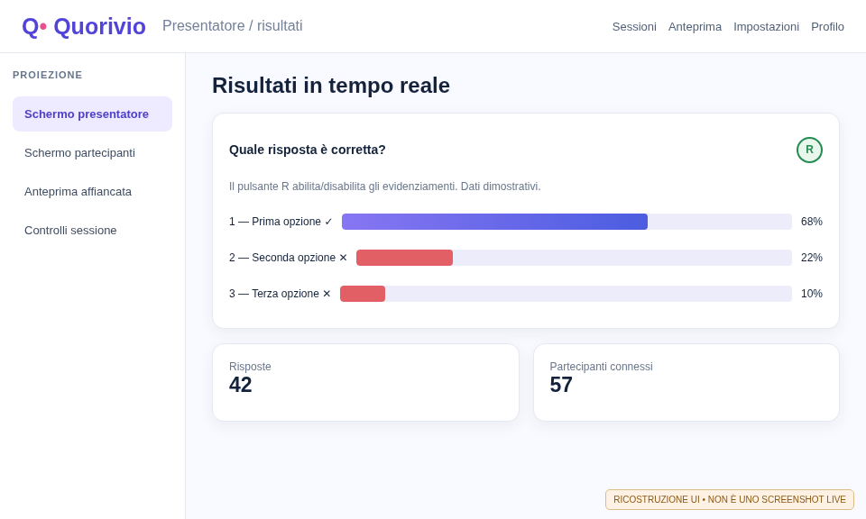<figcaption>Figure 3 — Reconstructed live results view with sample counts and the R button. These are not actual participant data.</figcaption></figure>

## 10. Ratings, reactions, Q&A and timers

The **rating** scale consists of **0–9 (ten selectable values)**, displayed using buttons or a dropdown, with an optional comment. Several independent rating widgets can reference separate questions, sessions or presenters. **Reactions** are independent emoji-based feedback controls; their icon size can be configured.

Audience questions can be submitted through **topic-question** and routed through a review workflow. Moderate text before displaying it publicly. Timers may stand alone or be attached to quizzes. Set the duration ahead of time and decide explicitly whether a restart retains or clears previous answers. Client-side countdowns do not override server-side acceptance rules.

## 11. Images, uploads and PDF/PPTX import

The asset library stores images, backgrounds, profile photos and reusable media. Choose meaningful filenames and check references before renaming or deleting. Ensure sufficient projection resolution, contrast and usage rights. The PDF/PPTX import feature uses a separately configured **isolated converter worker**; imported pages may be flattened to images. Do not promise editable text, original animations, videos or transitions from imported slides.

If conversion fails, ask an administrator to inspect the worker image, shared volume, token, upload policy and private logs. File type and size constraints are deployment-specific.

## 12. Desktop and smartphone layouts

Use the editor's **Desktop / Smartphone** selector to inspect both views. Mobile placements can be derived automatically from the desktop arrangement or explicitly customized. Confirm text sizes, long options, forms and buttons without unnecessary scrolling where content can fit. Manual mobile overrides should survive automatic reflow; inspect the actual device after rotating or changing browser size.

Desktop and mobile backgrounds can be configured separately where supported. A preview is not a substitute for real smartphone acceptance.

## 13. Presenter, audience and side-by-side previews

The **Presenter**, **Participant** and **Side-by-side** previews help rehearse navigation and independent screen behavior. Simulated submissions are not live audience responses. Participant rehearsal should produce graded feedback only after a simulated submission. The presenter can navigate pages and, where configured, show a different page to the audience. Avoid projecting administrative controls or answer keys before the intended reveal.

Always check QR links after public URL changes, including QR already exported to slides.

## 14. Running the live event

1. Sign in with an approved presenter account and select the correct session.
2. Prepare the private **Presenter screen** and the audience projection separately.
3. Check the invitation, active page, participant count and server connectivity.
4. Open the first interactive question and verify one server-confirmed test submission.
5. Monitor linked results without deleting or changing the IDs of choices with existing votes.
6. Use the **R** button only when appropriate to reveal grading on the presenter result.
7. Close response collection, proceed to the next page, export and end the event.

## 15. Import/export and retention

In the **sidebar** of an opened session, select **Export locally (.quo)** (*Esporta in locale*). Your browser downloads a self-contained, reimportable file containing slides, widgets, text, master schemes, **scheduled dates and calendar appointments**, settings and **all presenter-owned files in the session library**, even files not yet used on a slide. The server enforces an overall 100 MiB archive limit, 80 MiB in media and up to 300 attachments; reduce media before retrying if the limit is reached.

To **Import locally (.quo)** (*Importa da locale*), use the sidebar action (available even without an opened session), select a previously exported file and confirm the import. Quorivio **creates a new draft**, remaps all page/asset IDs, generates fresh access credentials and opens the imported copy. The original session is never overwritten. The server rejects invalid or tampered ZIP bundles. Check slide thumbnails, master schemes, media and linked results after import.

**A portable session is not an audience-data backup:** it deliberately excludes participant identities, responses, votes, analytics, history, original joining credentials and authentication secrets. Use separate CSV/Excel exports for statistics and administrator instance backups for full disaster recovery. Treat local archives as confidential if they contain copyrighted or sensitive uploaded media. PDF/PPTX and CSV/Excel exports remain available separately where supported. Complete instance backups belong to administrators, not individual presenters. Inspect data exports for personal information before sharing; apply organizational anonymization and access rules.

Deleting, resetting or invalidating an activity can affect reports. Record the reason for invalidation and communicate changes to aggregate results. Retention and erasure must follow the deployment's privacy policy.

## 16. Troubleshooting

| Symptom | Check |
|---|---|
| Empty or stale results | Confirm the question is open, votes were accepted and the linked source is correct. |
| R button missing | Check that the source question has an enabled grading key. |
| Highlight works in preview but not live | Check source IDs, authorization, activity state and server response. |
| QR opens an old event | Regenerate after changing public URL or invitation code. |
| Clipped editor content | Check font, fit mode, widget size and smartphone preview. |
| PDF/PPTX conversion fails | Check converter deployment and upload policy with an administrator. |
| Inconsistent saved layout | Check autosave status, concurrent edits and reopen carefully. |

## 17. Rehearsal checklist

- [ ] Account and permissions confirmed; use a separate rehearsal session.
- [ ] All required widgets visible, correctly sized and within the canvas.
- [ ] Arial-based typography and colors consistent across editor and previews.
- [ ] Desktop and actual smartphone readability checked.
- [ ] Single, multiple, text and 0–9 rating submissions tested.
- [ ] ✓/✕ feedback appears only after the answer is submitted.
- [ ] R toggle works on linked results, including cross-page sources.
- [ ] QR and invitation checked on a second device.
- [ ] Export reviewed; final audience session contains no test votes.

## 18. Glossary and verification limits

**Master:** reusable page design. **Canvas:** editable slide surface. **Results source:** question or other widget referenced by a chart. **Rehearsal:** simulation rather than live collection. **Grading key:** correct option IDs, withheld from the public before submission. **Audit:** administrative operation log.

This remains a `0.1.0-dev` build. Documentation alone does not certify full CI, physical devices, GDPR/AGID compliance or production readiness. All UI images in this manual are annotated reconstructions.

## Appendix A. End-to-end graded multiple-choice exercise

Create a test page with a **Question** widget titled “Which are operating systems?”. Add Linux (true), Windows (true) and a web browser (false). Select multiple-choice mode, enable the grading key and mark only Linux and Windows. Add a **Results** widget linked to the question, select bars and enable a hit-dependent gradient.

Open **Side-by-side rehearsal**, submit a correct combination from the participant side and confirm that no separate solution appears. Repeat with an incorrect combination and verify the overall verdict changes. In the presenter panel click the **R** toggle twice: first to reveal correct/incorrect markers, then to hide them. Save and reopen to verify that both the key and formatting persist.

## Appendix B. Cross-page results exercise

Create page A with a question and page B with a Results widget. In the result widget's properties select page A and the source widget; choose the intended subquestion where relevant. Preview page B and check that labels, counts, percentages and the R toggle refer to page A rather than a nearby, unrelated question.

Then reorder pages and test again. The link must use persistent widget/activity identifiers rather than relying only on visible page numbers. Repeat on the real Presenter screen in a disposable event: an editor preview does not by itself prove that PostgreSQL/WebSocket updates work in production.

<figure>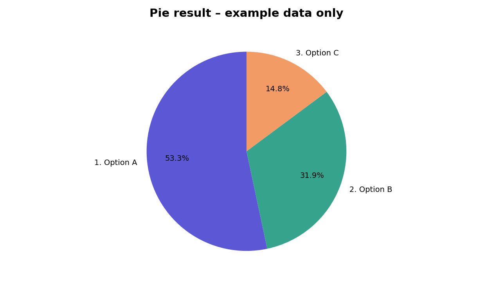<figcaption>Figure 4 — Invented sample values demonstrate percentages, choice numbering and consistent color usage.</figcaption></figure>

## Appendix C. Selecting a readable results view

| Goal | Suggested view | Rationale |
|---|---|---|
| Compare many categories | Horizontal bars | Long option labels can wrap. |
| Show shares of a few categories | Pie | Percentages and distinct colors show proportions. |
| Present exact counts | Table | Numbers remain explicit even for small categories. |
| Highlight recurring words | Word cloud | Visual weight can follow rank or frequency. |

Use bar gradients only when they improve separation without making low-count labels unreadable. For pie charts, choose distinguishable colors and retain a readable legend. The R button indicates **answer correctness**, not audience preference.

## Appendix D. Two-screen presentation workflow

Before the audience joins, connect the projector and separate the **private presenter screen** (navigation, moderation and controls) from the **public screen**. Position browser windows using the operating system. In a video meeting, share only the intended public window.

Confirm that presenter-only pages do not leak to participants, page numbering remains coherent, and a real phone follows page changes. Avoid exposing invitation secrets or administrative controls when troubleshooting a projected session.

## Appendix E. Document and media re-use

Before importing PDF/PPTX, verify that the isolated converter is configured and that the source file is permitted by policy. After importing, compare page count, order, aspect ratio, image cropping and mobile display. An imported page flattened to an image is **not** equivalent to editable text or native animations.

Use clear asset filenames and check references before deletion. After replacing an asset, verify every page and master that uses it. Thumbnails alone are insufficient for judging projection-resolution, transparency and color rendition.

## Appendix F. Operational risk during live voting

Unstable connectivity can delay result updates. Do not restart the application during collection without a recovery plan. Avoid changing option identifiers after votes have been recorded: this can break the mapping between historic responses and displayed aggregates.

Assess retention and reporting consequences before a reset, duplicate or deletion. For formal events, record who invalidated a question, when and why. Administrative audit information must remain restricted to authorized operators.

## Appendix G. Visual acceptance for every widget

Rehearse every relevant category: title, footer, text, note, shape, line, image, logo, video/PDF, QR, profile, timer, question/quiz, rating, reactions, participant count, topic-Q&A and results. For each, inspect **desktop editor → desktop preview → phone preview → Presenter screen → Participant screen** where applicable.

Document differences in placement, fonts, size, contrast, interaction, wrapping and visibility. Presenter-only widgets should not be expected to appear on the public participant display.

## Appendix H. Real screenshots and visual checks

This gallery includes only genuine Chromium captures of a running Quorivio CI instance using disposable database records and synthetic identities. SHA-256 evidence ties them to the source revision. They are not illustration composites and do not imply production security or functional certification.

<!-- REAL_SCREENSHOT_GALLERY -->

Editorial note: initial rewritten edition RC277; live screenshot/metadata workflow updated in RC278.

## Appendix I. Practical guided tour using real screenshots

1. Locate the navigation and open a **disposable test session** in the workspace screenshot.
2. Locate the editor canvas and the properties inspector. Create a question with answer choices, select a correct answer and confirm autosave.
3. Compare the **Presenter** rehearsal to the **Smartphone** rehearsal: participants must see legible content without presenter-only widgets.
4. During a dual-browser test inspect the live chart, the R toggle, the absence of early answer-key disclosure and the option-level verdict after submission.
5. Report visual differences using the exact build, browser, OS and screenshots. CI sample content does not reflect site-specific settings.

## Appendix L. Illustrated lab: editor, master and thumbnails

Use a disposable draft session with no real audience. Insert a multiple-choice question with three authored options. The left-hand thumbnails should reflect the **actual question text and options**, not just placeholder rectangles. Charts without live data remain schematic; a thumbnail must never claim fabricated response counts.

<figure>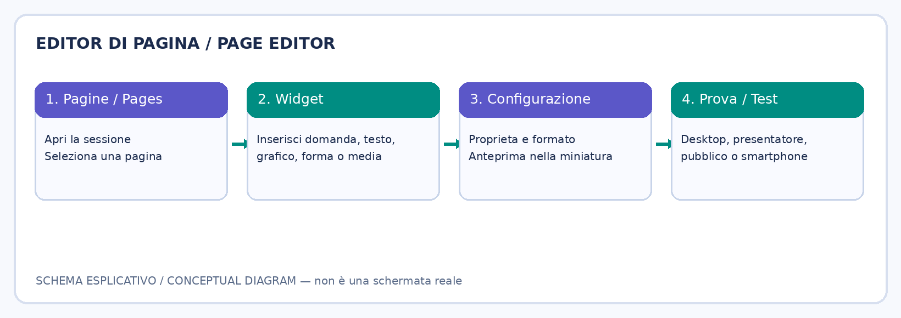 widget > properties > thumbnail > rehearsal."/><figcaption>CONCEPTUAL DIAGRAM — page editor > widget > properties > thumbnail > rehearsal.</figcaption></figure>

<figure>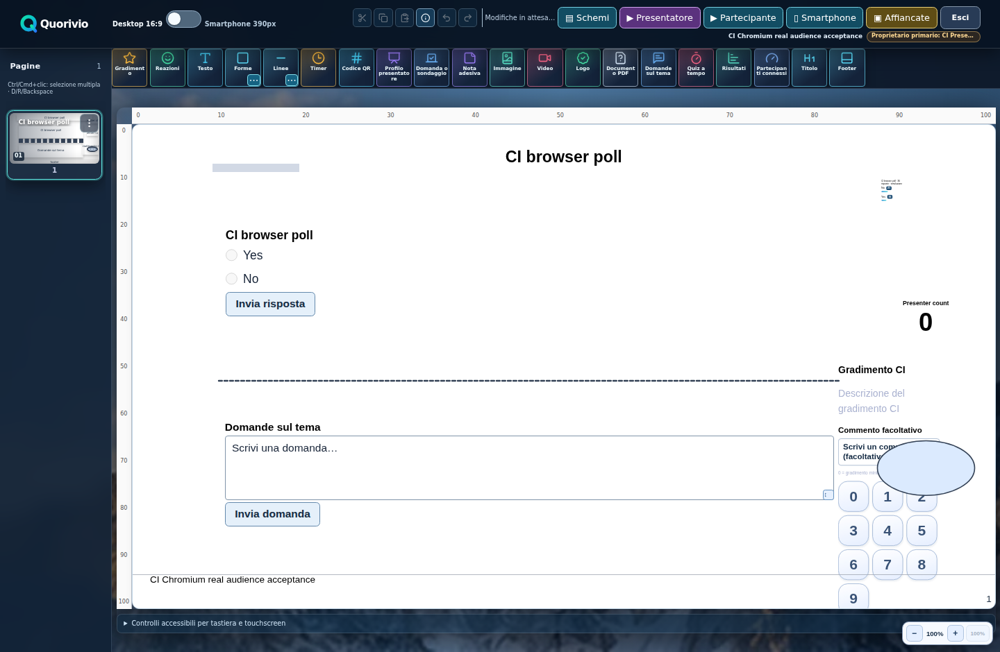<figcaption>ARCHIVED REAL SCREENSHOT — authoring interface on disposable sample data.</figcaption></figure>

### L.1 Build and inspect a page

1. Open the page editor, insert **Question** and fill in its title, answer mode and choices.
2. Check the thumbnail for captions, option labels, geometry, colors and media; the active page also reflects unsaved changes.
3. Add linked **Results**. Without a response dataset, the miniature shows a clearly schematic chart, never invented counts.
4. Insert timer, rating, reactions, image and shape; all must be visually distinguishable.
5. Compare the canvas, properties panel, formatting and thumbnail after editing each widget.

### L.2 Long widget context menus

<figure>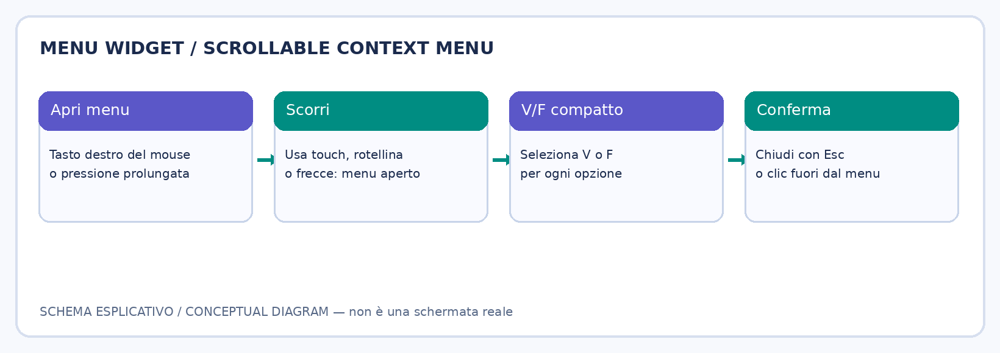<figcaption>CONCEPTUAL DIAGRAM — independently scrolling widget context menu.</figcaption></figure>

Right-click or long-press a widget. When the menu grows taller than the viewport, scroll *inside the menu* with mouse wheel or touch; it must remain open. True/false choices have compact **V/F** indicators, while complete question text remains available in widget properties. Press Escape or click outside to dismiss it.

### L.3 Global schemes and local overrides

<figure>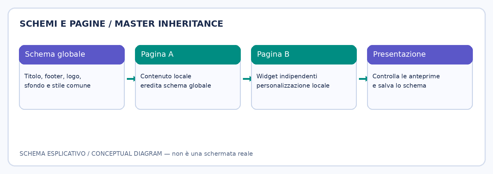<figcaption>CONCEPTUAL DIAGRAM — global master styles and independent page content.</figcaption></figure>

Open **Schemi** from the editor. Insert master Title and Footer; configure alignment, logo and global background, then save. Verify two distinct pages and any explicit local overrides. Test the smartphone background independently from the desktop background.

## Appendix M. Four rehearsal views

<figure>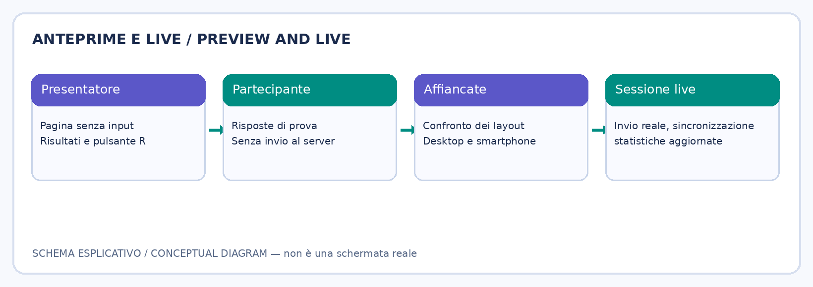<figcaption>CONCEPTUAL DIAGRAM — presenter, participant, side-by-side, smartphone and live.</figcaption></figure>

<figure>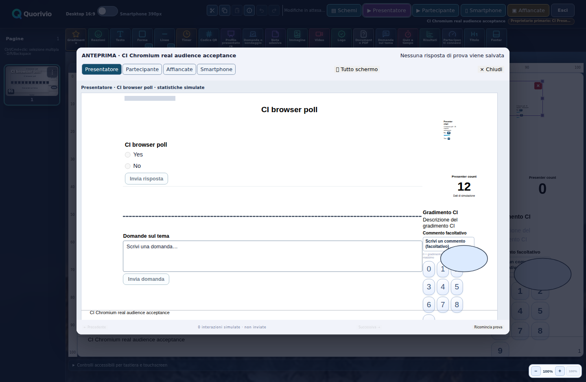<figcaption>ARCHIVED REAL SCREENSHOT — presenter rehearsal.</figcaption></figure>

<figure>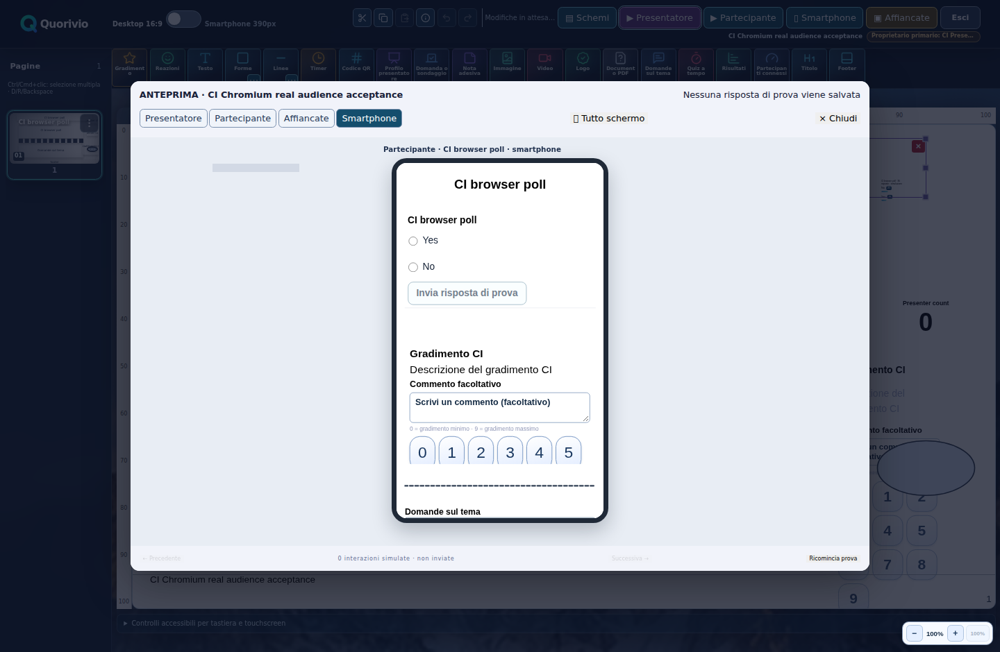<figcaption>ARCHIVED REAL SCREENSHOT — mobile rehearsal.</figcaption></figure>

1. **Presenter:** check slide design, linked results and the green R disclosure toggle.
2. **Participant:** submit rehearsal answers and verify direct green/red option outlines, without a separate answer-key disclosure block.
3. **Side by side:** compare views and test independent navigation without starting a live activity.
4. **Smartphone:** check responsive placement and mobile-specific background/typography.

Rehearsal submissions must not enter production statistics. Repeat all views after significant master or widget changes.

## Appendix N. Run a live session step by step

<figure>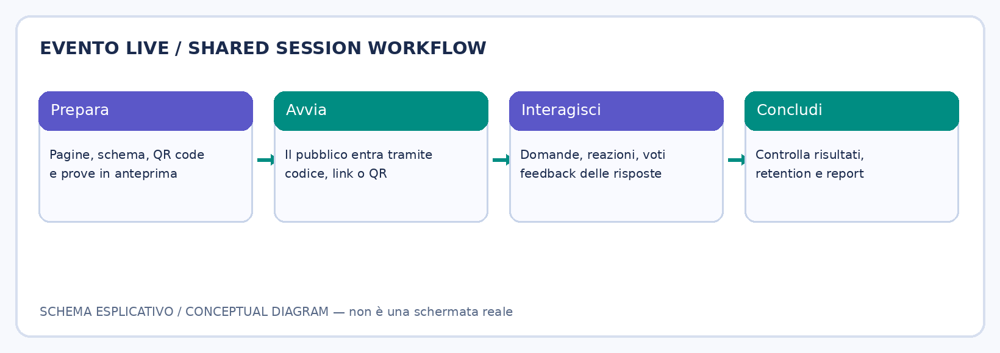<figcaption>CONCEPTUAL DIAGRAM — prepare, connect, interact, close.</figcaption></figure>

<figure>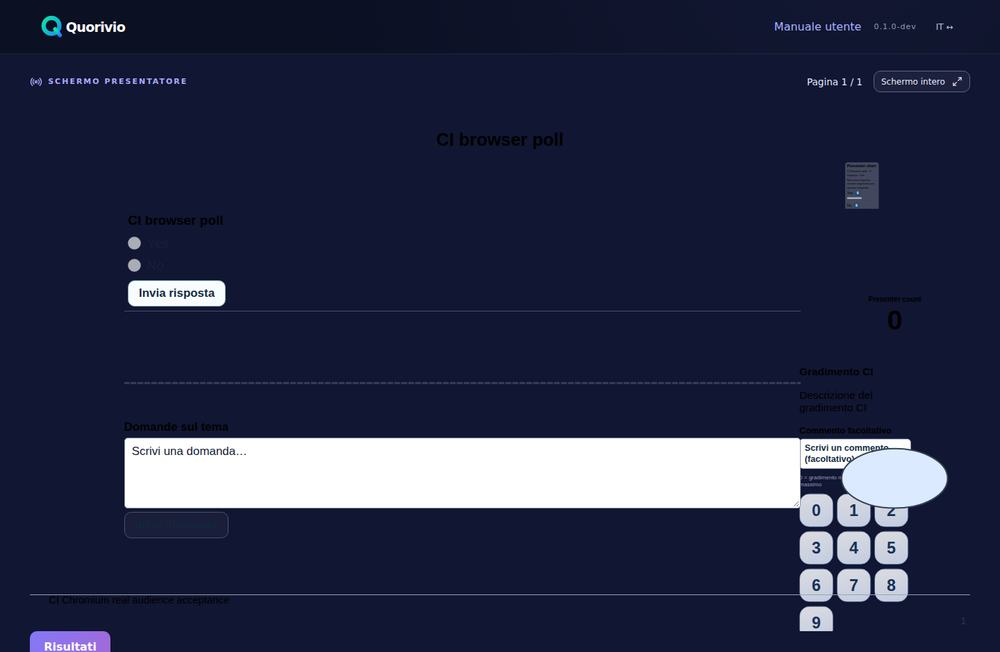<figcaption>ARCHIVED REAL SCREENSHOT — presenter projection.</figcaption></figure>

<figure><figcaption>SYNTHETIC EDITORIAL PHOTOGRAPHIC ILLUSTRATION — not a screenshot.</figcaption></figure>

**Before opening:** check HTTPS endpoint, code/QR updates, audience connectivity, and projector screen. **During:** invite participants, display relevant pages, monitor submissions, activate result charts and the R toggle as appropriate. If live connectivity drops, do not assume chart figures are fresh; verify reconnection. **Afterwards:** close the session, inspect outcomes, apply anonymization settings and observe GDPR retention.

## Appendix O. Export and import a complete .quo session

<figure>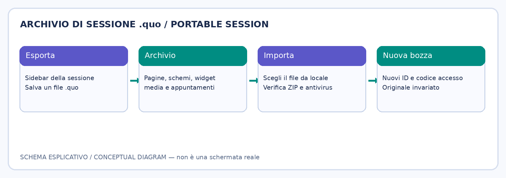<figcaption>CONCEPTUAL DIAGRAM — local .quo portable session transfer.</figcaption></figure>

<figure><figcaption>SYNTHETIC EDITORIAL PHOTOGRAPHIC ILLUSTRATION — collaborators, not application UI.</figcaption></figure>

Use **Export locally (.quo)** in the session sidebar. The file contains pages, widgets, masters, calendar entries and session-library assets including unused attachments; it excludes participants, credentials and responses. **Import locally (.quo)** creates a separate draft. Inspect thumbnails, media links, result sources and appointments. Portable sessions are not substitutes for administrator disaster-recovery backups.

## Appendix P. R answer highlights, Widget Formatting and bar gradients

**Correct/incorrect answer outlines.** In the editor, create a graded question and link a Results widget. In presenter preview, press the **circular R** in the widget's top-right corner: correct options show a thick green frame and incorrect options show a red frame. The frame has internal spacing that scales with the text, even with custom fonts and large font sizes, and adjacent frames must not overlap. Press **R** again to hide the verdicts. The old «Highlight correct» strip below the widget was removed because it could overlap the footer.

**Widget Formatting window.** Select a widget, open Format from its contextual menu and drag the window's corner to resize it. Switch between **Text**, **Borders**, **Effects**, **Contents** and **Links**: its outer width and height remain unchanged while the active tab's contents scroll inside. For bar results, open Contents, enable the **Gradient** option and choose the **Start colour** and **End colour** pickers. Intensity still reflects the response distribution; changing colours never changes counts. Save and verify the desktop preview with a second, deliberately large font.

**Navigation styling.** The sidebar uses visual icons for sessions, calendar, presenters, settings and `.quo` import. The active item uses a teal-green highlight. Commands remain accessible on desktop and adapted mobile layouts via keyboard or long press.

<figure><figcaption>Conceptual diagram: widget selection, contextual actions and formatting controls are separate tools. This is not a real app screenshot.</figcaption></figure>

## Compatibility and indicative hardware planning sheet

| Component | Deployment/client platforms | **Indicative** evaluation resources (verify on site) |
|---|---|---|
| Standalone/test server | Linux amd64/arm64 with Docker/Podman and PostgreSQL 18 | 2 vCPU, 4 GiB RAM, 20 GiB system disk **plus** database, media and backup volumes |
| Multi-node Kubernetes/HA | Linux Kubernetes nodes with NGINX/HAProxy ingress and actual RWX storage | At least 2 independent nodes for HA rehearsals; consider 4 vCPU/8 GiB per node as a benchmark starting point |
| Desktop browser | Current Chrome/Chromium, Firefox, Edge, Safari on Windows/macOS/Linux | Modern CPU, approximately 2 GiB free for the browser and an appropriate screen; presentation requires higher resolution |
| Smartphone/tablet | Current Android/iOS/iPadOS browsers | Approximately 2 GiB available RAM and a viewport of at least 360 CSS px recommended, reliable network |

These are **planning assumptions for evaluation**, not officially certified hardware minimums. Size production according to a documented concurrency/media/bandwidth benchmark. Antivirus, conversion services and backup jobs add substantial CPU, memory and storage requirements. Validate browser/mobile compatibility against the real same-build CI matrix before deployment.
