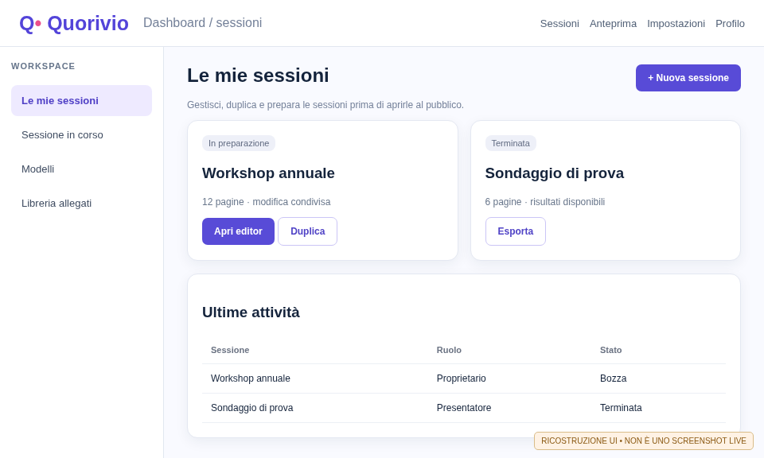
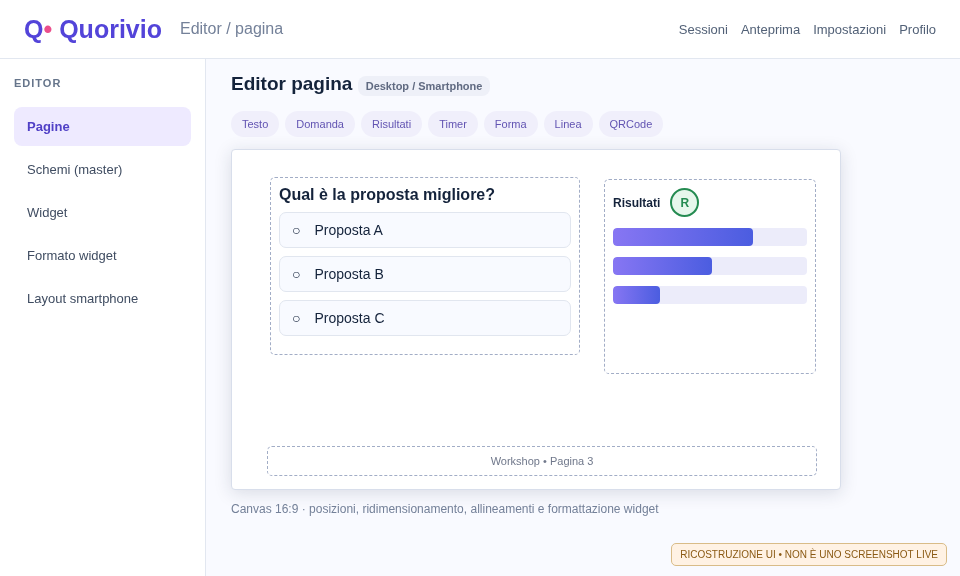
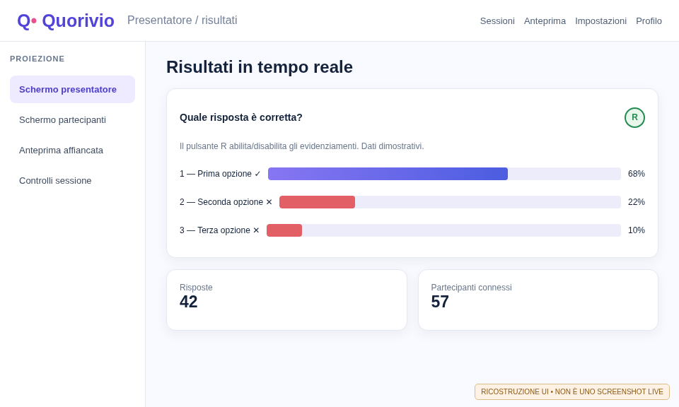
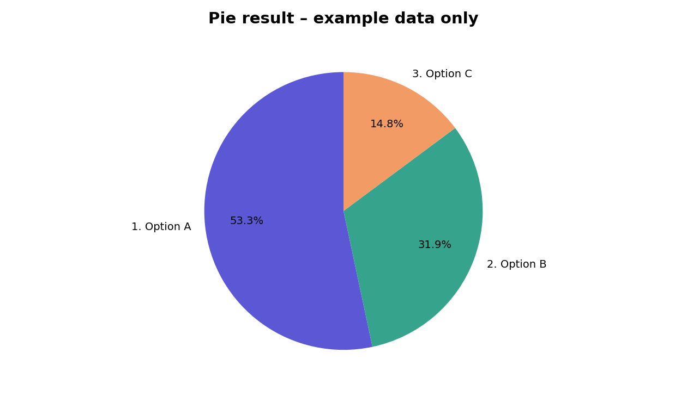

# Manuale del presentatore

**Quorivio 0.1.0-dev · Build documentale RC281 · 9 novembre 2026**

Guida di lavoro completa per creare, progettare, provare, condurre ed esportare una sessione. Descrive il codice RC276 con le correzioni vero/falso e il pulsante **R**. Le immagini illustrative dei capitoli principali sono **ricostruzioni esplicitamente etichettate**; la galleria finale dei PDF CI utilizza screenshot autentici acquisiti su un ambiente di prova e verificati per commit.

## 1. La sequenza operativa completa

La gestione di un evento comprende quattro fasi: **preparazione** (account, sessione, contenuti, widget), **prova** (anteprima desktop/smartphone e risposte simulate), **conduzione** (QR, avanzamento, apertura delle domande, risultati) e **chiusura** (esportazione, retention, archiviazione). Eseguire una prova da due dispositivi prima di proiettare la sessione a un pubblico reale.

| Fase | Operazione | Controllo prima di procedere |
|---|---|---|
| Preparare | Creare o aprire una sessione | Ruolo di presentatore approvato e sessione corretta. |
| Progettare | Definire pagine, schemi e widget | Nessun contenuto fuori dal canvas; modalità smartphone verificata. |
| Provare | Anteprima presentatore, partecipante e affiancata | Domande, feedback e grafici coerenti, QR aggiornato. |
| Condurre | Avviare la sessione e controllare la pagina pubblica | Nessun controllo amministrativo sul display pubblico. |
| Chiudere | Arrestare raccolta, esportare e archiviare | Dati, diritti dei collaboratori e retention verificati. |

<figure><figcaption>Figura 1 — Workspace ricostruito: gestione delle sessioni, stato, duplicazione e avvio dell'editor.</figcaption></figure>

## 2. Account e accessi

Il presentatore deve avere un account approvato. Il sistema può prevedere credenziali locali, LDAP, collegamenti federati o MFA a seconda della configurazione del server. L'amministratore decide l'abilitazione iniziale e il ruolo; non attribuire automaticamente privilegi sulla base della sola email o dell'appartenenza LDAP.

Dopo il login, controllare il profilo pubblico e l'eventuale fotografia. Le immagini pubblicate devono essere autorizzate; un'immagine Gravatar importata o caricata può richiedere aggiornamento e verifiche GDPR. Usare password diverse da quelle di test e attivare l'MFA se richiesto dall'organizzazione.

## 3. Gestire le sessioni dalla dashboard

### 3.1 Creazione e apertura

Dalla dashboard selezionare **Nuova sessione**, inserire un titolo significativo, confermare e aprire la sessione. La sidebar permette di passare rapidamente tra sessioni aperte. Distinguere la sessione di prova da quella effettiva; preferire una duplicazione senza risposte per costruire la copia definitiva.

### 3.2 Rinomina, duplicazione, chiusura, reset ed eliminazione

Usare le azioni associate alla sessione selezionata per rinominare, duplicare, chiudere o eliminare. La **duplicazione** crea un nuovo insieme di definizioni, senza importare automaticamente le risposte del pubblico. L'**eliminazione** è distruttiva e richiede conferma; verificare obblighi di conservazione e backup prima di procedere. Il reset dello stato della sessione si gestisce con gli strumenti autorizzati senza dover aprire una proiezione attiva.

### 3.3 Proprietario e collaboratori

Un proprietario può condividere una sessione con presentatori approvati, con permessi specifici. La proprietà può essere trasferita a un altro presentatore della stessa organizzazione con operazione controllata; decidere se il proprietario uscente debba restare collaboratore. Non utilizzare un account condiviso per risolvere conflitti di accesso.

## 4. Pianificare pagine e sequenza

Ogni sessione contiene pagine organizzate in una sequenza. Creare prima una scaletta (introduzione, sondaggio, risultati, confronto, Q&A, conclusione), quindi aggiungere le pagine. Utilizzare le miniature per **selezionare, riordinare, duplicare, rinominare e cancellare** con le operazioni disponibili nella barra contestuale. La numerazione deve riflettere la sequenza visualizzata; le pagine scartate per i partecipanti non devono produrre numerazioni confuse.

Un risultato può essere collegato a un widget domanda di un'altra pagina: scegliere esplicitamente pagina sorgente, widget e, se necessario, sottodomanda. Verificare il collegamento in anteprima prima di spostare o duplicare la sorgente.

## 5. L'editor visuale delle pagine

L'editor offre un **canvas** con righelli, selezione dei widget, spostamento, ridimensionamento, rotazione, strumenti di allineamento e un sistema di formattazione contestuale. Posizionare i widget sul canvas, non nello spazio occupato da sidebar o palette. La scala globale dell'interfaccia riduce gli elementi di controllo per lasciare più spazio al canvas: non cambia le coordinate dei contenuti salvati.

<figure><figcaption>Figura 2 — Ricostruzione editor 16:9, domanda, widget risultati e pulsante R. Il layout effettivo può variare in base alla configurazione.</figcaption></figure>

### 5.1 Gestione dei widget

Selezionare un widget dalla palette, collocarlo nella pagina, poi modificarne dimensione e posizione. Il doppio clic modifica i testi supportati; la finestra **Proprietà widget** regola contenuti e collegamenti, mentre **Formato widget** controlla font, dimensioni, colori, bordi, effetti, visualizzazione e formattazioni specifiche. Le finestre fluttuanti si possono spostare e ridimensionare.

### 5.2 Tastiera, appunti e cronologia

L'editor supporta selezioni multiple, **Taglia/Copia/Incolla**, **Annulla/Ripeti** e la cancellazione dei widget selezionati. Le frecce spostano gli oggetti secondo le regole dell'editor; i modificatori permettono variazioni di geometria dove previste. Salvare e riaprire la sessione per verificare la persistenza prima della proiezione.

### 5.3 Testo e formattazione indipendente

Il font di riferimento è **Arial**. È possibile applicare formattazione a tutto il widget o a un testo selezionato; l'editor conserva formattazioni specifiche per titolo, descrizione, opzioni di risposta e tasto di invio. Per le risposte lunghe prevedere ritorni a capo; non affidarsi a righe tagliate. Verificare allineamenti orizzontali/verticali e la continuità del carattere durante la digitazione.

## 6. Schemi (master), sfondi e footer

Gli **schemi di pagina** stabiliscono valori e widget predefiniti come titolo, footer, logo e sfondo. Aprire l'editor degli schemi dalla dashboard, modificarne gli oggetti con gli strumenti dell'editor pagine e applicare lo schema ai nuovi contenuti. Lo sfondo globale non deve cancellare una personalizzazione della singola pagina; verificare anche il comportamento sulle nuove pagine e nelle anteprime.

Il footer può mostrare il nome della sessione al centro e il numero pagina con margine interno; il separatore, l'allineamento e la tipografia si personalizzano. Le immagini di sfondo possono provenire dalla libreria di allegati, con gestione dei duplicati e dei riferimenti esistenti.

## 7. Catalogo completo dei widget

Il catalogo seguente deriva dalle tipologie di widget ammesse nello schema dati. La presenza di una tipologia nel codice non sostituisce una prova di compatibilità browser o di accessibilità della specifica installazione.

| Widget | Scopo | Proprietà / comportamento da verificare |
|---|---|---|
| **Titolo** (`title`) | Intestazione della pagina | Testo da pagina/master, font, posizione, visibilità. |
| **Footer** (`footer`) | Numero e descrizione in basso | Numero, testo, separatore, padding, allineamento. |
| **Testo** (`text`) | Contenuti liberi | Stili, a capo, selezione del testo, allineamento. |
| **Post-it** (`postit`) | Annotazione visuale | Riempimento, font, dimensioni, rotazione. |
| **Separatore** (`divider`) | Distanziamento visivo | Posizione e dimensione. |
| **Forma** (`shape`) | Grafica vettoriale | Rettangolo, ellisse, frecce, bordi e riempimento. |
| **Linea** (`line`) | Collegamenti visivi | Direzione, tratteggio, spessore, frecce terminali. |
| **Immagine** (`image`) | Foto, grafici e sfondi | Asset, ritaglio, proporzioni, testo alternativo. |
| **Logo** (`logo`) | Identità visiva | Origine del file, ridimensionamento e visibilità. |
| **Video** (`video`) | Clip in pagina | Controlli media, origine, comportamento mobile. |
| **PDF** (`pdf`) | Materiale documentale | Conversione/rappresentazione delle pagine importate. |
| **QR** (`qr`) | Invito del pubblico | URL corrente, aggiornamento automatico, leggibilità. |
| **Profilo** (`profile`) | Presentatore / relatore | Profilo scelto, foto, descrizione, email opzionale. |
| **Domanda** (`question`) | Risposta singola, multipla, libera o file | Opzioni, obbligatorietà, sottodomande, chiave vero/falso. |
| **Quiz a tempo** (`timed-quiz`) | Domanda con scadenza | Durata, selezione, valutazione, gestione timer. |
| **Domanda pubblico** (`topic-question`) | Q&A aperta | Campo domanda, raccolta e moderazione. |
| **Gradimento** (`rating`) | Voto e commento | Scala 0–9, stile pulsanti/menu, commento opzionale. |
| **Reazioni** (`reactions`) | Emozioni/feedback rapido | Tipo e dimensione delle emoji, modifica del voto. |
| **Risultati** (`results-button`) | Grafici e tabelle collegati | Fonte, domanda, bars/pie/table/cloud, pulsante R. |
| **Partecipanti** (`participant-count`) | Conteggio connessi | Numero aggregato, titolo e aggiornamento live. |
| **Timer** (`timer`) | Countdown | Durata, faccia clessidra/quadrante/digitale, restart. |

## 8. Costruire domande e sottodomande

### 8.1 Modalità di risposta

Il widget **Domanda** può acquisire selezione singola, multipla, testo libero o file. Definire un titolo, le opzioni (fino ai limiti imposti dal backend), le condizioni di obbligatorietà e l'eventuale permesso di modificare una risposta. Le **sottodomande** sono indipendenti per titolo, opzioni e regola di valutazione; non confondere l'ID della sottodomanda con l'ID del widget contenitore.

### 8.2 Configurare le risposte vere/false

Aprire **Proprietà widget** oppure **Formato widget → Contenuti**, abilitare la funzione di risposta corretta e indicare quali opzioni sono vere. Per una domanda singola selezionare **una sola opzione corretta**; per una multipla selezionare l'insieme delle opzioni vere. Valutare ogni sottodomanda separatamente. Fare una prova di invio in **Anteprima partecipante**.

### 8.3 Come appare il feedback

Dopo un invio confermato, il partecipante riceve il verdetto e vede le singole opzioni con bordo **verde + ✓** (corrette) o **rosso + ✕** (errate). Non aggiungere una sezione separata «Soluzione» sotto le risposte. La chiave resta non disponibile al partecipante prima dell'invio: verificare questo comportamento anche su un secondo browser.

## 9. Widget Risultati: collegamenti, grafici e colori

### 9.1 Collegare un'origine dati

Aggiungere un widget **Risultati**, scegliere il widget sorgente e l'eventuale pagina e sottodomanda di riferimento. Controllare che il titolo, l'etichetta della risposta e il conteggio corrispondano alla fonte scelta, anche quando la pagina sorgente è diversa da quella corrente.

### 9.2 Tipi di visualizzazione

| Tipo | Punti fondamentali |
|---|---|
| Barre | Una barra per opzione con conteggio; possibile gradiente basato sul numero di risposte. |
| Torta | Percentuali sulle fette opzionali, numerazione delle risposte opzionale e colore della fetta coerente con il testo dell'opzione. |
| Tabella | Conteggio leggibile e ordinamento coerente con la sorgente. |
| Nuvola di parole | Dimensione/rango proporzionali ai conteggi; gestione a capo delle etichette lunghe. |

### 9.3 Formato widget e singole righe

In **Formato widget** impostare l'eventuale numero della domanda, le percentuali, il gradiente barre e i colori delle singole opzioni. Le impostazioni di testo di ciascuna risposta e riga risultato sono indipendenti: dimensione, tipo di font, colore e enfasi possono differire da quelli del titolo.

### 9.4 Pulsante circolare R

Quando è presente una chiave vero/falso, accanto al widget Risultati appare un **pulsante circolare R verde**. Il clic è un toggle: prima pressione mostra ✓/✕ e contorni colorati sulle alternative, seconda pressione li nasconde. Deve funzionare nell'editor, nell'anteprima e nello **Schermo presentatore**, anche per un risultato collegato a una domanda di un'altra pagina. Il pulsante non modifica le risposte né la chiave di valutazione.

<figure><figcaption>Figura 3 — Ricostruzione del risultato live: R verde, grafico, conteggi e opzioni identificate. Valori puramente illustrativi.</figcaption></figure>

## 10. Gradimento, reazioni, Q&A e temporizzazioni

Il **gradimento è da 0 a 9 (dieci valori)**; è configurabile come pulsanti o menu e può comprendere commento facoltativo fino al limite previsto. È possibile creare più gradimenti indipendenti e collegarli a specifici widget o presentatori. Le **reazioni** sono un widget separato con emoji e dimensioni personalizzabili. Il Q&A/topic-question riceve testo pubblico o moderato; usare i controlli di approvazione quando disponibili prima di mostrare contenuti in sala.

I timer possono essere autonomi o associati a quiz. Definire la durata prima dell'apertura e documentare la scelta quando si riavvia, in particolare se si mantengono o si azzerano risposte già registrate. Il timer visuale non sostituisce la validazione del server.

## 11. Immagini, allegati, PDF e PPTX

La **libreria degli allegati** offre caricamento e riutilizzo di sfondi, foto, video e loghi. Usare nomi riconoscibili; prima di eliminare o rinominare un asset controllarne l'uso nelle pagine e negli schemi. Scegliere immagini leggibili in proiezione, con risoluzione appropriata e autorizzazione di utilizzo.

Per importare un documento PDF o PPTX, usare la funzione di importazione nell'editor/gestione allegati. Il servizio utilizza un **worker di conversione isolato** configurato dall'amministratore; l'importazione può trasformare le pagine in immagini e **non conserva necessariamente animazioni, transizioni o contenuti editabili**. In caso di worker non disponibile, chiedere all'amministratore di verificare container, token, volume e log.

## 12. Layout smartphone, desktop e sfondi

L'editor permette di verificare la vista **Desktop** e **Smartphone**. Il layout mobile può essere derivato automaticamente dal desktop o personalizzato manualmente: controllare i testi lunghi, le opzioni e i bottoni senza affidarsi allo scroll quando vi è spazio per compattare. Una modifica manuale va preservata dalle rigenerazioni automatiche.

Lo sfondo smartphone si configura separatamente da quello desktop dove previsto. Dopo aver cambiato l'orientamento o la larghezza della finestra, ricontrollare geometrie e leggibilità. L'anteprima di smartphone non sostituisce una prova su dispositivo fisico.

## 13. Anteprime, presentazione e sincronizzazione delle pagine

Sono previste viste **Presentatore**, **Partecipante** e **Affiancate**. Provarle prima dell'evento e usare lo schermo corretto in videoproiezione. Le anteprime possono simulare risposte senza incidere sui risultati reali; nell'anteprima partecipante il feedback vero/falso segue la simulazione dell'invio.

Durante la sessione il presentatore può avanzare o tornare di pagina e, dove configurato, visualizzare ai partecipanti una pagina differente dalla propria. Non mostrare i controlli di amministrazione o le chiavi di risposta sulla proiezione pubblica. Verificare sempre l'URL e il QR dopo modifiche dell'indirizzo pubblico.

## 14. Condurre un evento reale

1. Accedere con l'account presentatore approvato; aprire la sessione corretta.
2. Preparare in una finestra privata lo **Schermo presentatore** e in una finestra separata il display pubblico.
3. Controllare QR, link, disponibilità del server, numero dei partecipanti e sincronizzazione pagina.
4. Aprire la domanda e attendere che una risposta di prova venga confermata dal server.
5. Monitorare risultati senza cambiare identificativi delle opzioni già votate.
6. Usare il toggle **R** solo quando si desidera rivelare le risposte corrette nel risultato mostrato dal presentatore.
7. Chiudere la raccolta, aprire la pagina successiva, esportare e terminare la sessione.

## 15. Esportazioni, importazioni e ciclo di vita

La gestione delle sessioni può comprendere **esportazione/importazione delle definizioni** (senza statistiche), PDF/PPTX e dati in CSV/Excel secondo i formati effettivamente presenti in dashboard. La copia completa dell'istanza non è responsabilità del singolo presentatore: è operazione amministrativa. Controllare sempre il contenuto di un file prima di condividerlo; le esportazioni dei risultati possono contenere dati riferibili ai partecipanti e richiedono anonimizzazione.

La modifica della retention o la cancellazione della sessione deve rispettare gli obblighi dell'organizzazione. Prima di invalidare una domanda o azzerare risultati, registrare la ragione dell'intervento e comunicare l'effetto sui grafici.

## 16. Problemi frequenti

| Sintomo | Controllo |
|---|---|
| Risultati vuoti o non aggiornati | Verificare che l'attività sia aperta, che i voti siano stati accettati e che la fonte collegata sia corretta. |
| Pulsante R assente | Verificare l'abilitazione della chiave vero/falso nella domanda sorgente. |
| Risposte evidenziate in anteprima ma non live | Controllare sessione, permessi, sorgente e disponibilità dei dati. |
| QR non porta alla nuova sessione | Rigenerare il QR dopo cambi dell'URL pubblico o dell'invito. |
| Editor con contenuti tagliati | Verificare font, adattamento automatico, dimensioni del widget e vista smartphone. |
| PDF/PPTX non convertito | Chiedere verifica del converter e del limite upload al server admin. |
| Salvataggio incongruente | Controllare stato di sincronizzazione, conflitti di collaborazione e riaprire la sessione con cautela. |

## 17. Checklist per la prova d'accettazione

- [ ] Account e permessi validi; sessione separata per i test.
- [ ] Tutti i widget descritti nella scaletta visibili e correttamente dimensionati.
- [ ] Font Arial e colori coerenti fra editor, anteprime e proiezione.
- [ ] Preview desktop e smartphone controllate su dimensioni reali.
- [ ] Una risposta singola, multipla, testuale e un gradimento 0–9 registrati.
- [ ] Feedback ✓/✕ mostrato dopo la risposta, mai prima.
- [ ] Pulsante R funzionante come toggle anche sui risultati di pagina diversa.
- [ ] QR e URL verificati dal secondo dispositivo.
- [ ] Esportazione di prova verificata; nessun dato di test nella sessione definitiva.

## 18. Glossario e limiti di validazione

**Schema/master:** impostazioni e oggetti predefiniti di pagina. **Canvas:** superficie visuale di progettazione. **Sorgente risultati:** domanda o altro widget collegato a un grafico. **Preview:** simulazione, non raccolta reale. **Chiave vero/falso:** opzioni considerate corrette, non accessibili al partecipante prima dell'invio. **Audit:** registrazione amministrativa delle operazioni.

L'applicazione è `0.1.0-dev`: la documentazione non equivale ad approvazione della full CI, collaudo dei dispositivi fisici o certificazione GDPR/AgID. Le schermate illustrate sono ricostruzioni annotate.

## Appendice A. Esercitazione completa: domanda multipla corretta

Costruire una pagina di prova con widget **Domanda** dal titolo «Quali sono sistemi operativi?». Inserire tre risposte: Linux (vera), Windows (vera), un browser Web (falsa). Selezionare risposta multipla, abilitare la chiave vero/falso e spuntare soltanto Linux e Windows. Aggiungere un widget **Risultati** collegato alla stessa domanda, scegliere grafico a barre e usare l'opzione gradiente.

Avviare **Anteprima affiancata**, inviare una selezione corretta dal lato partecipante e controllare l'assenza di qualsiasi soluzione separata. Selezionare successivamente una risposta errata e verificare il verdetto complessivo diverso. Nel lato presentatore fare clic sul pulsante **R** due volte: la prima deve mostrare gli indicatori delle opzioni, la seconda nasconderli. Salvare e riaprire l'editor per controllare la persistenza della chiave e della formattazione.

## Appendice B. Esercitazione: risultati tra pagine diverse

Creare pagina A con una domanda e pagina B con un widget Risultati. In **Proprietà widget risultati** selezionare la pagina A e il relativo widget; se la domanda contiene sottodomande, scegliere quella corretta. Nell'anteprima della pagina B verificare che etichette, conteggi, percentuali e pulsante R si riferiscano alla domanda di pagina A, non a una domanda casuale della pagina B.

Riordinare poi le pagine e riprovare. Il collegamento deve usare gli ID persistenti dei widget/attività, non dipendere solo dal numero visibile della pagina. Ripetere l'operazione nello Schermo presentatore con un evento di prova: una simulazione dell'editor non dimostra automaticamente che la stessa richiesta dati funzioni con PostgreSQL e WebSocket reali.

<figure><figcaption>Figura 4 — Diagramma con dati inventati: numeri e percentuali dimostrano la lettura di una torta e il riuso dei colori.</figcaption></figure>

## Appendice C. Scelta del grafico più leggibile

| Obiettivo | Rappresentazione suggerita | Perché |
|---|---|---|
| Confrontare molte categorie | Barre orizzontali | Le etichette lunghe possono andare a capo. |
| Visualizzare quote di poche categorie | Torta | Percentuali e colori distinti facilitano la lettura. |
| Mostrare conteggi esatti | Tabella | Ogni numero è esplicito, anche per valori piccoli. |
| Evidenziare parole ricorrenti | Nuvola | Dimensione grafica proporzionale al rango. |

Usare il gradiente delle barre quando la differenza fra risposte è rilevante, ma non lasciare che la scala cromatica renda poco leggibili le categorie meno votate. Per le torte, scegliere colori sufficientemente distinti e mantenere la legenda con testo leggibile. Il pulsante R riguarda **correttezza**, non gradimento o preferenza del pubblico.

## Appendice D. Una presentazione in due schermi

Prima dell'ingresso del pubblico, collegare il proiettore e distinguere **schermo privato del presentatore** (controlli, anteprime, moderazione) e **schermo pubblico** (pagina mostrata ai partecipanti). Usare il browser o le funzioni del sistema operativo per collocare correttamente le finestre. In una videoconferenza, condividere solo la finestra pubblica.

Verificare che eventuali pagine escluse dal pubblico non vengano mostrate accidentalmente, che il footer conti le pagine correttamente e che il cambio pagina sia percepito anche da uno smartphone. In caso di problemi non mostrare segreti di sessione o strumenti di amministrazione durante il troubleshooting pubblico.

## Appendice E. Importazione e riutilizzo delle risorse

Per aggiungere un documento PDF/PPTX, assicurarsi che il converter sia abilitato e che il file rispetti la policy dell'istanza. Dopo l'importazione confrontare numero e ordine delle pagine, rapporto d'aspetto, ritaglio immagini e comportamento mobile. Il PDF importato come immagine **non** equivale a un documento editabile; la modifica del testo richiede l'editor dei widget o una conversione compatibile.

Nella libreria allegati utilizzare nomi descrittivi e verificare riferimenti prima della cancellazione. Se un file viene sostituito, ricontrollare tutte le pagine e gli schemi dove è usato. Non affidarsi alla sola miniatura per verificare risoluzione, trasparenza e colore di immagini destinate alla sala.

## Appendice F. Gestione del rischio durante l'evento

Una connessione instabile può ritardare l'arrivo dei voti; i risultati possono aggiornarsi con periodicità diversa da quella della presentazione. Evitare di interrompere o riavviare il server nel mezzo della raccolta. Per una domanda già votata, non modificare identificativi delle opzioni: un cambiamento può compromettere l'associazione fra risposte storiche e grafici.

Prima di qualsiasi reset, duplicazione o cancellazione, valutare l'effetto sulla conservazione e sui report. In un evento formale, registrare data, responsabile e motivo delle invalidazioni delle risposte. In caso di incidente usare l'audit amministrativo senza esporre i dati di partecipazione a chi non è autorizzato.

## Appendice G. Verifica visiva di tutti i widget

Eseguire almeno un ciclo per tipologia: testo, titolo, footer, forma, linea, immagine, logo, video/PDF, QR, profilo, timer, domande e quiz, gradimento, reazioni, contatore partecipanti, Q&A e risultati. Per ciascun elemento controllare **editor desktop → anteprima desktop → anteprima smartphone → schermo presentatore → schermo partecipante** dove la tipologia è pertinente.

Registrare le incongruenze per ogni vista: posizione, font, dimensione, contrasto, interazione, avvolgimento del testo e visibilità. Per widget accessibili solo al presentatore non interpretare la loro assenza dallo schermo partecipante come un difetto.

## Appendice H. Schermate reali e controlli visuali

La galleria mostra soltanto acquisizioni genuine da un Quorivio avviato in CI, con database e identità di prova. Le schermate sono correlate al commit con SHA-256. Non derivano da composizioni illustrate. Le schermate sono una guida all’uso, non prove di certificazione funzionale o di sicurezza.

<!-- REAL_SCREENSHOT_GALLERY -->

Nota editoriale: riscrittura iniziale in RC277; revisione metadati e processo schermate RC278.

## Appendice I. Percorso pratico da seguire con le schermate reali

1. Nello screenshot «workspace» riconoscere l'area di navigazione, creare una **sessione di prova** e verificarne il titolo.
2. Passare all'editor: la schermata del **canvas** mostra il posizionamento dei widget. Aprire le proprietà di una domanda e definire opzioni e risposta corretta; verificare il salvataggio prima di uscire.
3. Aprire l'anteprima **Presentatore** e confrontarla con **Smartphone**: lo schermo partecipante deve mantenere testi leggibili, senza widget riservati al presentatore.
4. In una prova con due browser controllare risultati, pulsante R, nascondimento della soluzione prima dell'invio e feedback correttamente mostrato soltanto dopo l'invio.
5. Conservare il report e comunicare all'amministratore eventuali differenze fra screenshot CI e installazione operativa indicando build, browser e sistema operativo.

**Dati di prova:** i contenuti nelle immagini raccolte in CI sono sintetici e possono avere etichette in inglese. Non usare screenshot CI per dedurre la configurazione effettiva della propria organizzazione.

## Scheda tecnica di compatibilità e requisiti indicativi

| Ambito | Piattaforme utilizzabili | Risorse **indicative**, da validare |
|---|---|---|
| Server standalone/laboratorio | Linux amd64/arm64 con container Docker o Podman, PostgreSQL 18 | 2 vCPU, 4 GiB RAM, 20 GiB disco di sistema **oltre** ai volumi di database, media e backup |
| Server Kubernetes/HA | Linux su più nodi Kubernetes, ingress NGINX/HAProxy, storage RWX reale | Almeno 2 nodi distinti per test HA; considerare 4 vCPU/8 GiB per nodo come punto di partenza da misurare |
| Browser desktop | Chrome/Chromium, Firefox, Edge e Safari aggiornati su Windows/macOS/Linux | CPU recente, circa 2 GiB RAM liberi per il browser, display adeguato; la proiezione richiede maggiore risoluzione |
| Browser smartphone/tablet | Browser aggiornati su Android/iOS/iPadOS | Circa 2 GiB RAM disponibili e viewport di almeno 360 CSS px raccomandati; Wi-Fi/dati stabili |

I valori sono **ipotesi prudenziali per pianificare i test**, non minimi ufficialmente certificati da benchmark. Per un evento con molti partecipanti servono prove di carico con numero utenti, quantità di media, simultaneità delle risposte e banda misurati. Il requisito minimo può cambiare con antimalware, conversione documenti, importazioni e backup. Per eventuali limitazioni di WebKit/Safari, touch e dispositivi più vecchi, consultare gli esiti reali della matrice CI della stessa build.
