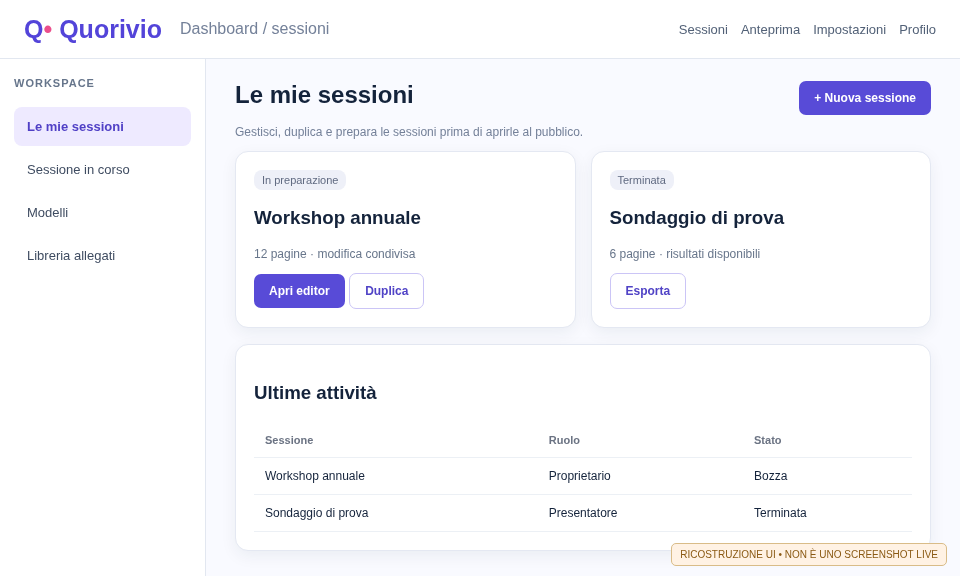
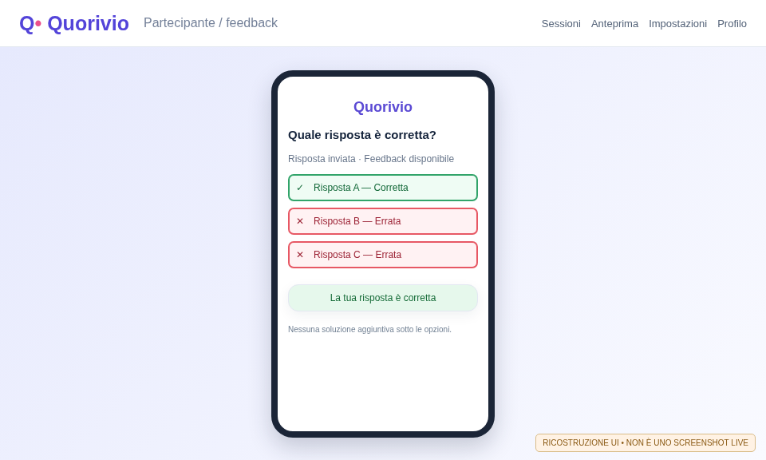
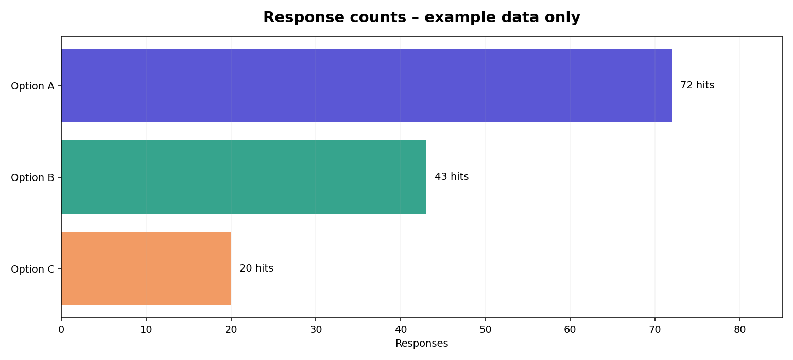

# Participant guide

**Quorivio 0.1.0-dev · Documentation build RC278 · 9 November 2026**

This guide explains how to join an interactive session, answer questions, understand feedback and use the available features on a phone or computer. It documents the RC276 application code as reviewed for documentation cycle RC278. The earlier illustrated screens are labelled reconstructions; the final gallery in CI-produced PDFs contains real captures of a disposable test instance, **never production captures**.

## 1. What is Quorivio?

Quorivio supports interactive presentations. Presenters arrange pages with text, questions, charts and other widgets. Participants enter through a link, QR code or session code and interact from their browser; no native installation is required. Submitted answers are processed by the server and may contribute to the charts displayed by the presenter.

**Roles:** participants submit answers where allowed; presenters choose the current page and control activity availability; administrators manage accounts, storage, retention and server configuration. Interface-level anonymity does not imply that the service processes no technical data. Consult the privacy notice of the specific deployment.

| Requirement | Practical guidance |
|---|---|
| Modern browser on phone, tablet or desktop | Keep the browser updated and allow JavaScript. |
| Network access | Verify connectivity before the event starts. |
| Session URL or QR | Use the invitation provided for the current event. |
| Optional nickname | Avoid unnecessary identifying information. |

<figure><figcaption>Figure 1 — An illustrative session workspace. Participants do not receive the presenter's private controls.</figcaption></figure>

## 2. Join a session

### 2.1 Scan the QR code

1. Open the phone camera and point it at the QR shown by the presenter.
2. Open the suggested HTTPS link; confirm it belongs to the intended Quorivio instance.
3. Enter a nickname if requested and complete the join process. Anonymous joining may be enabled or disabled by the deployment.
4. Wait for the presenter to open an interactive page. A waiting screen does not necessarily indicate an error.

### 2.2 Enter a code or URL

Open the organizer-provided application address and select the join action. Copy the code accurately, without additional spaces. If a link is supplied, paste it directly into the address bar. An expired or rotated invitation must be replaced with a new one. Do not redistribute private invitations without permission.

### 2.3 Accounts and reconnection

Registration is not approval. In deployments requiring authorization, an administrator must approve the account before sign-in is permitted. An LDAP password may be verified during self-registration without granting access. After a brief disconnection, try reopening the invitation in the same browser. Changing devices or clearing cookies may create a different participant identity.

## 3. Reading the participant screen

The participant screen usually follows the page selected by the presenter. Mobile placement is adapted to the device and may differ from the desktop arrangement. A page can include a question, image, video, timer, submit control, rating, emoji reactions, QR code and other content. Read the complete question, the permitted number of selections, required fields and any time limit before submitting.

If the presenter moves to another page while you are typing, confirm that your original question is still open. The app cannot promise that unfinished input on a closed page will be accepted.

## 4. Single choice, multiple choice and answer grading

### 4.1 Single choice

Select one radio option, then choose **Submit answer** when the page requires explicit submission. Changing your choice before submission is not a second vote. The server validates that the activity is open and the option exists.

### 4.2 Multiple choice

Tick the relevant checkboxes and submit. In a graded question, you may be asked to select every true statement. Selecting multiple choices in one submission is different from submitting multiple separate answers.

### 4.3 Feedback after submitting

When the presenter enables an answer key, a *confirmed* submission can show an overall correct/incorrect verdict. Each answer option is highlighted **in place**: a green outline and ✓ for correct options, a red outline and ✕ for incorrect ones. **The solution is not displayed as an additional list beneath the choices.** The public page does not disclose the grading key before submission. The verdict depends on the authored answer key and the actual submission result.

<figure><figcaption>Figure 2 — Illustrative phone feedback: green/red borders and symbols appear on the choices themselves, not in a separate answer key.</figcaption></figure>

| Indicator | Meaning |
|---|---|
| ✓ and green outline | Option identified as correct by the authored key. |
| ✕ and red outline | Option identified as incorrect. |
| Correct answer | The entire submitted selection satisfies the grading rule. |
| Incorrect answer | The selection does not satisfy the grading rule. |
| No indicators | Grading disabled, no submission yet, or the question is not gradable. |

## 5. Timed quiz and timers

A timed quiz accepts submissions according to the server-side activity deadline. A visual hourglass, dial or digital timer helps track remaining time but does not guarantee acceptance after the deadline. If the page closes while sending, rely on the server response rather than assuming the answer was recorded.

The presenter may restart a timer and choose whether to retain or reset certain responses. Opening several browser tabs does not bypass server-side timing controls.

## 6. Free-text answers and file submissions

### 6.1 Text input

Write your response in the provided field and select the submit control. Required text fields cannot be empty. Avoid unsolicited personal information, medical details or names of other people. Open-text submissions may be visible to authorized presenters and included in an export.

### 6.2 File upload

Where the question allows file attachments, choose the document, follow the upload controls and wait for confirmation. Allowed sizes, file types and antivirus checks depend on server configuration. A rejected upload is not a successful submission. Upload sensitive files only when explicitly required and authorized.

## 7. Ratings, reactions and comments

The **rating widget uses ten values from 0 to 9**, as buttons or a dropdown. An optional comment field can accompany the score. Ratings measure opinion; they are not quiz answers. The widget may relate to a topic, a session or a presenter.

**Emoji reactions** allow choosing one of the available symbols. A deployment or widget may let participants change an earlier vote. Do not interpret a reaction as a formal quiz answer unless the question explicitly defines it that way.

## 8. Audience questions and moderation

A **topic-question** widget allows participants to submit questions to the presenter. Depending on the active workflow, a moderator may review submissions, publish approved questions or enable votes on them. Submitting does not necessarily make a question public. Keep questions concise, appropriate and free of unrelated personal data.

Aggregated content such as a **word cloud** can be displayed by the presenter. Potentially identifying or inappropriate contributions should be moderated before public presentation.

## 9. Other widget types you may encounter

| Widget | What a participant sees or does |
|---|---|
| Title and footer | Page context and numbering, no submission. |
| Text, note and shapes | Instructions or visual content. |
| Image, logo and video | Media content; video may provide playback controls. |
| QR code | Public invitation to join. |
| Presenter profile | Public details selected by the organizer. |
| Participant count | Aggregated current count, not participant identities. |
| Result chart | Aggregated responses when presenter permits their display. |

## 10. Privacy and accessibility

Submitted content may be stored in PostgreSQL alongside technical data needed for the service. Each deployment must provide its own privacy notice and name the relevant data controller. Interface anonymity is not the same as immediate data deletion and should not encourage unnecessary data collection.

Use browser zoom, suitable phone orientation and labelled controls as needed. Green/red borders are paired with ✓/✕ symbols so grading is not communicated by color alone. If a feature is inaccessible to assistive technology, report the page, device, browser and action to the organizer.

## 11. Troubleshooting

| Symptom | Recommended check |
|---|---|
| QR does not open | Check network, URL, HTTPS certificate and invitation validity. |
| Session ended | Ask the presenter for a reopened or replacement session. |
| Activity closed | Wait for the next page; users cannot reopen activities themselves. |
| No submission confirmation | Check connectivity; avoid duplicates if the server already accepted the answer. |
| Text will not fit | Follow the widget's published length limits. |
| No grading symbols | Grading might be disabled for this question. |
| Rating displays 0–9 | This is the expected scale in this build, not 0–10. |

## 12. Practice workflow

Before a live event, join a test invitation, enter a nickname, submit a single-choice answer, confirm the server response, try a 0–9 rating and an emoji reaction, then ask the presenter to advance the page. In graded questions, verify that option highlights appear **after**, never before, submission. Do not use the final public event for practice responses unless the organizer plans to remove them.

## 13. Glossary

**Session:** event pages and controls. **Page:** one presenter-selected display. **Widget:** one visual or interactive component. **Preview:** simulation that does not replace live acceptance. **Confirmed submission:** answer accepted by the server. **Moderation:** approval of publishable content. **Retention:** configured period during which records are kept.

**Validation scope:** this guide documents intended behavior in the RC276 codebase. It does not certify particular browsers, physical devices, LDAP/SMTP servers or Kubernetes clusters.

## Appendix A. Worked example of correct and incorrect answers

**Illustrative question:** “Which of these are input devices?” with keyboard, monitor and mouse as choices. In multiple-choice mode, select keyboard and mouse and submit once. If grading is enabled, keyboard and mouse are highlighted in green with ✓ and monitor in red with ✕ after the server accepts the answer. A correct overall verdict requires satisfying the complete grading rule, not simply selecting at least one correct item.

If you also select monitor, the overall response can be marked incorrect even though keyboard and mouse retain green outlines. **Option outlines describe the authored answer key**, while the overall message judges your submitted attempt. Read them together.

## Appendix B. An activity with no grading key

**Example:** “Which topic should we discuss next?” This is a preference rather than a right/wrong quiz. If the presenter has not configured a grading key, there is no objectively wrong option: a successful submission should display confirmation, not an invented correct-answer verdict. Any associated chart represents the number of preferences, not correctness.

<figure><figcaption>Figure 3 — Invented counts used to illustrate reading a poll. They are not results from a running deployment.</figcaption></figure>

## Appendix C. What happens to a submission

The complete journey is **select → check required fields → send HTTPS request → validate session and activity on server → record → return confirmation or error**. A button click does not guarantee a successful transaction. After confirmation, the browser may refresh and the presenter may see new aggregates. Reconnection must use server state rather than treating an unconfirmed click as a recorded vote.

Wait for the confirmation, particularly on a weak connection. When reporting a failure, share non-sensitive details such as approximate time, page and browser, not screenshots containing someone else's personal information.

## Appendix D. Shared access and personal information

Do not submit answers for other people, share private login credentials or publish confidential quiz outcomes in outside chats. Comments may become part of exported reports. For correction or deletion under the event policy, contact the organizer. Removing your browser history does not necessarily delete records stored on the server.

## Appendix E. Self-check table

| Check | Expected behavior |
|---|---|
| HTTPS URL and recognized host | Invitation reaches the authorized instance. |
| Page title | Matches the question you intend to answer. |
| Single choice | Only one answer option may be selected. |
| Multiple choice | Several choices can be ticked before explicit submission. |
| Graded question | ✓/✕ appears after confirmation, not before. |
| Rating | Exactly 0,1,2,3,4,5,6,7,8,9. |
| Closed activity | New submissions are rejected with an understandable message. |
| Page change | Audience updates without exposure of private presenter controls. |

## Appendix F. Authentic screenshots from the tutorial

This gallery includes only genuine Chromium captures of a running Quorivio CI instance using disposable database records and synthetic identities. SHA-256 evidence ties them to the source commit. They are not illustration composites and do not imply production security or functional certification.

<!-- REAL_SCREENSHOT_GALLERY -->

Editorial note: initial rewritten edition RC277; live screenshot/metadata workflow updated in RC278.

## Appendix G. Practical example: join, respond and confirm

Follow the screenshot gallery in sequence: login (for registered users), **mobile session entry** using a code or link, **mobile question**, and **submission feedback**. Use a pseudonym rather than unnecessary personal details. Select an answer, submit once, and wait for server confirmation. In graded single/multiple-choice questions, green/red option outlines apply **after** submission; the interface must not add a separate full answer-key list below the choices.

CI screenshots use fictional data, not real event participants. If your mobile layout differs, check the “Phone layout / 16:9 slide” control and report the browser version to the presenter.

## Compatibility and indicative hardware planning sheet

| Component | Deployment/client platforms | **Indicative** evaluation resources (verify on site) |
|---|---|---|
| Standalone/test server | Linux amd64/arm64 with Docker/Podman and PostgreSQL 18 | 2 vCPU, 4 GiB RAM, 20 GiB system disk **plus** database, media and backup volumes |
| Multi-node Kubernetes/HA | Linux Kubernetes nodes with NGINX/HAProxy ingress and actual RWX storage | At least 2 independent nodes for HA rehearsals; consider 4 vCPU/8 GiB per node as a benchmark starting point |
| Desktop browser | Current Chrome/Chromium, Firefox, Edge, Safari on Windows/macOS/Linux | Modern CPU, approximately 2 GiB free for the browser and an appropriate screen; presentation requires higher resolution |
| Smartphone/tablet | Current Android/iOS/iPadOS browsers | Approximately 2 GiB available RAM and a viewport of at least 360 CSS px recommended, reliable network |

These are **planning assumptions for evaluation**, not officially certified hardware minimums. Size production according to a documented concurrency/media/bandwidth benchmark. Antivirus, conversion services and backup jobs add substantial CPU, memory and storage requirements. Validate browser/mobile compatibility against the real same-build CI matrix before deployment.
