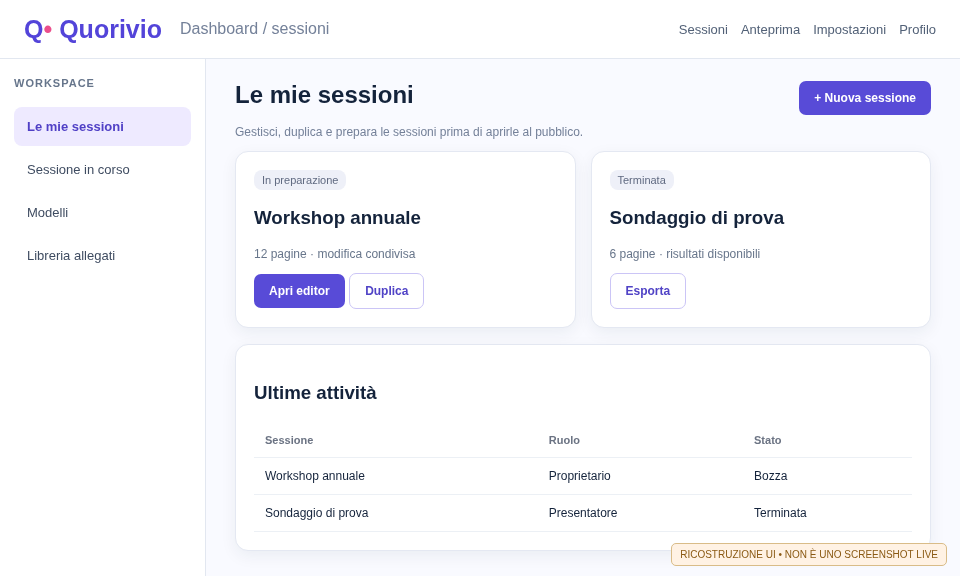
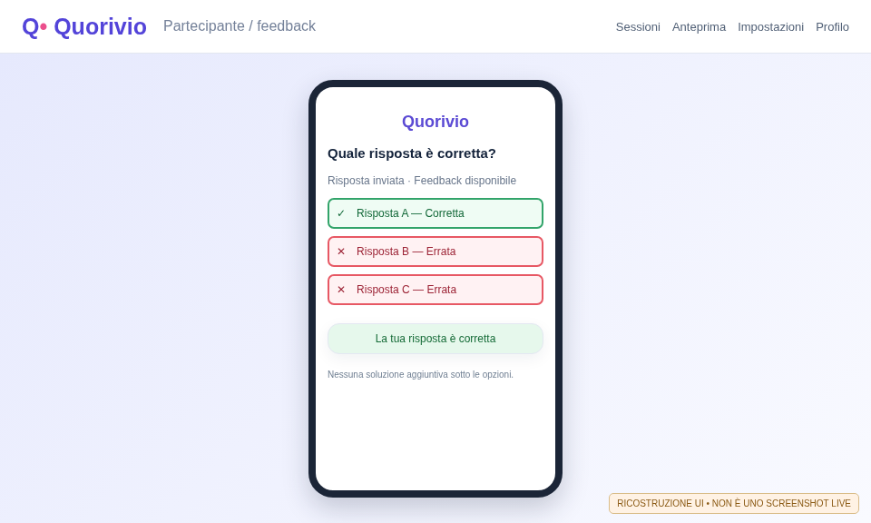
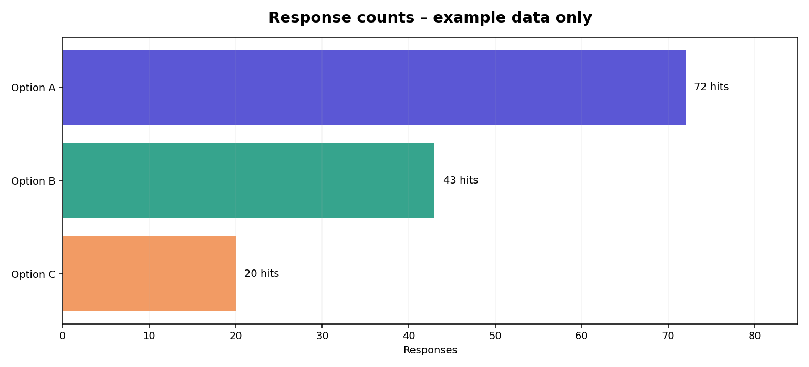

# Guida del partecipante

**Quorivio 0.1.0-dev · Build documentale RC279 · 9 novembre 2026**

Questa guida spiega come partecipare a una sessione interattiva, rispondere ai diversi tipi di domanda, interpretare gli esiti e usare correttamente le funzioni disponibili da smartphone o computer. È riferita al codice della RC276 e alla revisione editoriale RC278. Le prime figure sono ricostruzioni etichettate; la galleria finale nei PDF generati dalla CI usa screenshot autentici acquisiti sull'istanza di prova temporanea, **non su un server di produzione**.

## 1. Conoscere Quorivio

Quorivio è un sistema di presentazioni interattive: il presentatore prepara pagine con testo, domande e widget; i partecipanti accedono con un collegamento, un QR code o un codice sessione e interagiscono dal browser. Non occorre installare un'app nativa. Le risposte e gli aggiornamenti passano attraverso il server e possono concorrere ai grafici mostrati dal presentatore.

**Ruoli:** il partecipante invia risposte dove autorizzato; il presentatore decide quale pagina è visibile e quando le attività sono aperte; gli amministratori gestiscono account, conservazione e impostazioni del server. Essere anonimi nell'interfaccia non significa assenza di dati tecnici: consultare l'informativa privacy dell'istanza.

| Cosa serve | Consiglio pratico |
|---|---|
| Browser moderno su smartphone, tablet o desktop | Aggiornare il browser e consentire JavaScript. |
| Connessione Internet o alla rete aziendale | Verificare Wi-Fi/dati mobili prima dell'evento. |
| Collegamento o QR della sessione | Usare quello mostrato dal presentatore per l'evento corrente. |
| Eventuale nickname | Scegliere un nome non contenente dati personali non necessari. |

<figure><figcaption>Figura 1 — Vista illustrativa dell'organizzazione di una sessione. I partecipanti non accedono ai comandi riservati al presentatore.</figcaption></figure>

## 2. Entrare nella sessione

### 2.1 Inquadrare il codice QR

1. Aprire la fotocamera e inquadrare il QR proiettato o inviato dall'organizzatore.
2. Aprire il collegamento HTTPS proposto dal telefono; controllare che appartenga all'istanza prevista.
3. Inserire il nickname se richiesto e confermare l'ingresso. Alcune installazioni ammettono partecipanti anonimi; altre richiedono un account.
4. Attendere che il presentatore apra una pagina interattiva. Un messaggio di attesa non indica necessariamente un errore.

### 2.2 Inserire un codice o un link manualmente

Aprire l'indirizzo dell'istanza comunicato dall'organizzatore e usare la funzione di partecipazione. Copiare il codice senza spazi aggiuntivi; per un link completo è preferibile incollarlo nel browser. Se il codice viene rigenerato o la sessione è scaduta, chiedere un nuovo invito. Non distribuire link di eventi privati senza autorizzazione.

### 2.3 Autenticazione, sessioni private e riconnessione

La registrazione di un account non equivale all'approvazione: se l'organizzazione applica un flusso autorizzativo, un amministratore deve abilitare l'account. L'accesso tramite LDAP può verificare la password ma non concedere l'accesso finché l'utente è in stato pendente. Per una disconnessione temporanea, riprovare dallo stesso browser; cambiare browser o cancellare cookie può produrre una nuova identità di partecipazione.

## 3. Orientarsi nello schermo partecipante

La pagina partecipante segue di norma la pagina scelta dal presentatore. Su smartphone la disposizione è adattata alle dimensioni del dispositivo e può essere diversa da quella desktop; l'obiettivo è preservare leggibilità e controlli senza richiedere uno zoom eccessivo. Nelle pagine possono comparire domanda, immagini, un video, timer, tasti di invio, gradimento, reazioni e un QR.

**Prima di rispondere:** leggere il testo completo, verificare il numero di scelte consentite, eventuale scadenza temporale e obbligatorietà della risposta. Se il presentatore passa a un'altra pagina mentre si scrive, verificare che il campo sia ancora disponibile prima di inviare.

## 4. Scelta singola, scelta multipla e valutazione vero/falso

### 4.1 Scelta singola

Selezionare una sola opzione e premere **Invia risposta** quando richiesto. Cambiare la scelta prima dell'invio non registra una nuova risposta. Il server controlla che l'attività sia ancora aperta e che l'opzione sia valida.

### 4.2 Scelta multipla

Selezionare le caselle desiderate e poi inviare. Quando sono configurate opzioni vere/false, la domanda può richiedere di scegliere tutte le alternative corrette. Non confondere la possibilità di selezionare più opzioni con il diritto di inviare più risposte separate.

### 4.3 Che cosa appare dopo l'invio

Quando il presentatore ha abilitato la valutazione delle risposte, dopo una risposta confermata compare un verdetto complessivo (corretta o sbagliata) e **ogni opzione è evidenziata direttamente**: bordo verde e ✓ per una corretta; bordo rosso e ✕ per una sbagliata. **Non viene aggiunta sotto le risposte una seconda lista contenente la soluzione.** Prima dell'invio la pagina pubblica non deve esporre la chiave delle risposte. Il feedback dipende dalla configurazione della domanda e dalla risposta effettivamente registrata.

<figure><figcaption>Figura 2 — Esempio illustrativo di feedback dopo la conferma: simboli e bordi sono applicati alle opzioni, non a una soluzione separata.</figcaption></figure>

| Elemento | Interpretazione |
|---|---|
| ✓ e bordo verde | Alternativa identificata come corretta dalla chiave della domanda. |
| ✕ e bordo rosso | Alternativa identificata come errata. |
| «Risposta corretta» | Il complesso delle selezioni inviate soddisfa la regola della domanda. |
| «Risposta sbagliata» | La selezione non soddisfa la regola della domanda. |
| Nessun evidenziamento | Valutazione non abilitata, risposta non ancora inviata oppure pagina non valutabile. |

## 5. Quiz a tempo e timer

Un widget quiz a tempo associa la raccolta a una durata definita dal presentatore. Controllare l'indicatore di tempo e inviare prima della chiusura server-side. Un timer a clessidra, quadrante o digitale è un ausilio visivo: non presume che una risposta tardiva venga accettata. Se la pagina viene chiusa durante l'invio, leggere il messaggio di errore; non considerare registrata una risposta senza conferma.

Se il presentatore riavvia il timer può scegliere di mantenere o azzerare alcune risposte secondo il flusso configurato. Non tentare di aggirare il limite aprendo più schede: la validità è controllata dal server.

## 6. Risposte libere e allegati

### 6.1 Risposta testuale

Scrivere nel campo della domanda e premere il tasto di invio previsto. Se è obbligatoria, non è possibile inviare una risposta vuota. Evitare dati sanitari, nomi completi e informazioni personali non strettamente necessarie; il testo può diventare visibile al presentatore o essere esportato dall'organizzatore.

### 6.2 Domanda con caricamento di file

Se la domanda consente un allegato, scegliere il documento e attendere il completamento del caricamento. Dimensione, estensione e scansione antivirus dipendono dalla configurazione del server. Un file rifiutato non deve essere considerato consegnato. Non caricare documenti riservati se non richiesti e autorizzati.

## 7. Gradimento, reazioni e commenti

Il widget **Gradimento** usa **10 valori da 0 a 9**, visualizzati come pulsanti o selettore; un eventuale campo commento facoltativo può accompagnare il voto. Il gradimento non è un quiz corretto/sbagliato. La scala e l'etichetta dipendono dalla pagina e possono riferirsi a un tema, alla sessione o a un presentatore.

Le **Reazioni** consentono di selezionare un'emoticon prevista dal widget; la modifica del voto può essere consentita dalle regole della sessione. Non interpretare un'emoji come risposta a una domanda se non viene richiesto esplicitamente.

## 8. Domande al pubblico e moderazione

Un widget **Domande del pubblico / topic-question** permette di scrivere una domanda destinata al presentatore. In base al flusso attivato possono essere presenti moderazione, elenco delle domande approvate e votazioni. Un testo inviato non è automaticamente visibile a tutti: attendere l'approvazione. Utilizzare un linguaggio appropriato, conciso e privo di informazioni personali di terzi.

I risultati aggregati, come la **nuvola di parole**, possono essere selezionati dal presentatore per la visualizzazione pubblica; le parole offensive o identificative devono essere moderate prima della pubblicazione.

## 9. Altri contenuti della pagina

| Widget | Comportamento per il partecipante |
|---|---|
| Titolo e footer | Contestualizzano la pagina e il numero, senza richiesta di risposta. |
| Testo, post-it e forme | Forniscono istruzioni o contenuti visivi. |
| Immagine, logo e video | Mostrano materiale; un video può disporre di controlli di riproduzione. |
| QR code | Rimanda al collegamento pubblico di partecipazione. |
| Profilo presentatore | Mostra le informazioni pubbliche che l'organizzatore ha configurato. |
| Contatore partecipanti | Visualizza un conteggio aggregato, non un elenco di identità. |
| Grafici risultati | Presentano aggregati, quando resi visibili dal presentatore. |

## 10. Privacy e accessibilità

Le risposte possono essere memorizzate in PostgreSQL insieme a dati necessari al funzionamento. L'installazione deve fornire la propria informativa e indicare il titolare del trattamento. L'anonimato dell'interfaccia non equivale a cancellazione immediata, né autorizza il trattamento di dati personali superflui.

Per l'accessibilità, usare l'ingrandimento del browser, orientare correttamente il telefono e preferire tasti con etichette. Il colore verde/rosso è accompagnato da ✓/✕ per offrire un'indicazione non esclusivamente cromatica. Se un widget non è fruibile con tecnologia assistiva, segnalare pagina, dispositivo e operazione all'organizzatore.

## 11. Risoluzione dei problemi

| Sintomo | Verifica e azione consigliata |
|---|---|
| QR non apre la sessione | Verificare URL, rete, certificato HTTPS e validità dell'invito. |
| «Sessione terminata» | Il presentatore deve riaprire o creare una nuova sessione; non si può forzare dal client. |
| «Attività chiusa» | Attendere la successiva pagina o chiedere al presentatore. |
| Invio senza conferma | Controllare la rete; evitare invii duplicati se il server ha già registrato la risposta. |
| Il testo non entra nel campo | Verificare i limiti indicati dal widget; utilizzare una risposta più breve. |
| Non si vede la valutazione | La chiave vero/falso può non essere abilitata; non è un errore necessario. |
| Gradimento mostra 0–9 | È la scala prevista in questa versione, non 0–10. |

## 12. Esercitazione guidata

**Prova consigliata prima di un evento:** aprire l'invito da un dispositivo di test, inserire un nickname, rispondere a una scelta singola, verificare il messaggio di invio, provare un gradimento 0–9 e una reazione, quindi chiedere al presentatore di cambiare pagina. Per le domande valutate osservare che l'evidenziazione compare **solo dopo** l'invio. Non svolgere la prova nella sessione pubblica definitiva se i voti di prova non saranno rimossi.

## 13. Glossario essenziale

**Sessione:** insieme delle pagine e dei controlli dell'evento. **Pagina:** schermata presentata durante la sessione. **Widget:** componente visuale o interattivo della pagina. **Anteprima:** simulazione che non sostituisce il collaudo dal vivo. **Risposta confermata:** invio accettato dal server. **Moderazione:** decisione del presentatore su contenuti pubblicabili. **Retention:** durata di conservazione stabilita dall'installazione.

**Stato di collaudo:** questa guida descrive il comportamento previsto dal codice della RC276. Non rappresenta una certificazione degli specifici browser, dispositivi, server LDAP/SMTP o cluster Kubernetes.

## Appendice A. Esempio completo di quiz corretto e sbagliato

**Scenario illustrativo:** viene posta la domanda «Quali dei seguenti elementi sono dispositivi di input?», con le opzioni tastiera, monitor e mouse. Se è prevista una scelta multipla, selezionare tastiera e mouse e inviare una sola volta. Se l'organizzatore ha abilitato la correzione, dopo l'invio la tastiera e il mouse sono contornati in verde con ✓, il monitor in rosso con ✕. L'indicazione complessiva è corretta solo se la selezione rispetta la regola impostata; non è sufficiente aver selezionato almeno una delle opzioni corrette.

Se viene invece selezionato anche il monitor, il server può marcare la risposta complessiva sbagliata pur indicando con il bordo verde le due opzioni corrette. **La cornice delle opzioni descrive la chiave della domanda**, mentre il messaggio complessivo giudica il tentativo inviato. Le due informazioni vanno lette insieme.

## Appendice B. Esempio di attività senza correzione

**Scenario:** «Quale tema dovrebbe essere affrontato nel prossimo incontro?». Questa è una preferenza, non un quiz a risposta corretta. Se il presentatore non ha configurato una chiave vero/falso, nessuna risposta è oggettivamente errata: dopo l'invio deve apparire soltanto la conferma della registrazione. L'eventuale grafico mostra il numero di preferenze raccolte; non è una graduatoria di correttezza.

<figure><figcaption>Figura 3 — Conteggi di esempio inventati per mostrare come leggere un sondaggio; non sono statistiche dell'applicazione in esercizio.</figcaption></figure>

## Appendice C. Percorso di un invio sul server

La procedura completa è: **selezione → controllo locale dei campi richiesti → invio HTTPS → verifica di sessione e attività sul server → registrazione → conferma o errore**. Il semplice clic non garantisce una transazione riuscita. Se la risposta è stata confermata, il browser può aggiornare la schermata e il presentatore può vedere nuovi risultati. Una riconnessione deve ricaricare lo stato attendibile dal server anziché inventare un voto riuscito.

È consigliabile attendere un messaggio di conferma, soprattutto se la rete è debole. Per problemi persistenti comunicare all'organizzatore un riferimento non sensibile (ora, codice della pagina, browser) evitando screenshot con dati privati di altre persone.

## Appendice D. Accesso condiviso e dati personali

Non inviare più risposte per conto di terzi, non condividere i propri codici di accesso privati e non pubblicare su chat esterne il risultato di domande riservate. Se il presentatore permette commenti, ogni testo può entrare nei report. Per correggere o cancellare una risposta secondo le regole dell'evento, rivolgersi agli organizzatori: cancellare la cronologia del telefono non elimina necessariamente la registrazione lato server.

## Appendice E. Scheda di autoverifica

| Verifica | Esito atteso |
|---|---|
| L'URL contiene un dominio noto e HTTPS | Collegamento a un'istanza autorizzata. |
| La pagina mostra il titolo corretto | Si sta rispondendo all'attività desiderata. |
| Selezione singola | Una sola opzione selezionabile. |
| Selezione multipla | Più opzioni selezionabili, invio esplicito. |
| Risposta vero/falso valutata | ✓/✕ compaiono dopo la conferma. |
| Gradimento | Scala esattamente 0,1,2,3,4,5,6,7,8,9. |
| Attività chiusa | Nuovi invii respinti con messaggio comprensibile. |
| Cambio pagina | La vista del partecipante si aggiorna senza esporre controlli privati. |

## Appendice F. Schermate autentiche da esercitazione

La galleria mostra soltanto acquisizioni genuine da un Quorivio avviato in CI, con database e identità di prova. Le schermate sono correlate al commit con SHA-256. Non derivano da composizioni illustrate. Le schermate sono una guida all’uso, non prove di certificazione funzionale o di sicurezza.

<!-- REAL_SCREENSHOT_GALLERY -->

Nota editoriale: riscrittura iniziale in RC277; revisione metadati e processo schermate RC278.

## Appendice G. Esempio pratico: accesso, risposta e conferma

Nella galleria seguire nell'ordine: schermata di login (solo per utenti registrati), **accesso smartphone** tramite link/codice, **domanda smartphone** e **feedback**. Inserire un nome convenzionale, non dati personali non necessari. Selezionare una risposta e inviarla una sola volta; attendere un messaggio di ricezione. Nei quiz che prevedono la valutazione vero/falso, i bordi verdi e rossi indicano l'esito delle singole opzioni **dopo** l'invio; non viene aggiunto sotto alle opzioni un elenco separato delle soluzioni.

La schermata della CI contiene risposte dimostrative e non dati di un evento reale. Se il dispositivo mostra un layout diverso, controllare l'eventuale selettore «Layout smartphone / Diapositiva 16:9» e segnalare al presentatore la versione del browser.

## Scheda tecnica di compatibilità e requisiti indicativi

| Ambito | Piattaforme utilizzabili | Risorse **indicative**, da validare |
|---|---|---|
| Server standalone/laboratorio | Linux amd64/arm64 con container Docker o Podman, PostgreSQL 18 | 2 vCPU, 4 GiB RAM, 20 GiB disco di sistema **oltre** ai volumi di database, media e backup |
| Server Kubernetes/HA | Linux su più nodi Kubernetes, ingress NGINX/HAProxy, storage RWX reale | Almeno 2 nodi distinti per test HA; considerare 4 vCPU/8 GiB per nodo come punto di partenza da misurare |
| Browser desktop | Chrome/Chromium, Firefox, Edge e Safari aggiornati su Windows/macOS/Linux | CPU recente, circa 2 GiB RAM liberi per il browser, display adeguato; la proiezione richiede maggiore risoluzione |
| Browser smartphone/tablet | Browser aggiornati su Android/iOS/iPadOS | Circa 2 GiB RAM disponibili e viewport di almeno 360 CSS px raccomandati; Wi-Fi/dati stabili |

I valori sono **ipotesi prudenziali per pianificare i test**, non minimi ufficialmente certificati da benchmark. Per un evento con molti partecipanti servono prove di carico con numero utenti, quantità di media, simultaneità delle risposte e banda misurati. Il requisito minimo può cambiare con antimalware, conversione documenti, importazioni e backup. Per eventuali limitazioni di WebKit/Safari, touch e dispositivi più vecchi, consultare gli esiti reali della matrice CI della stessa build.
